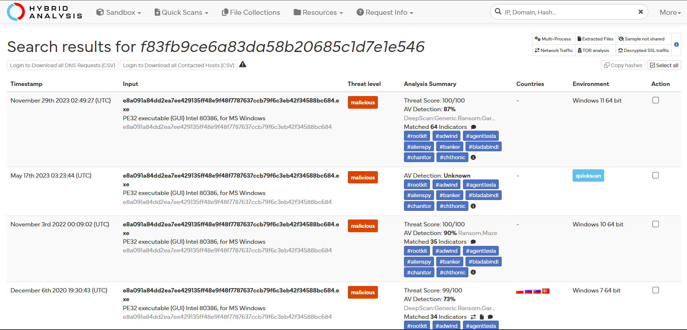
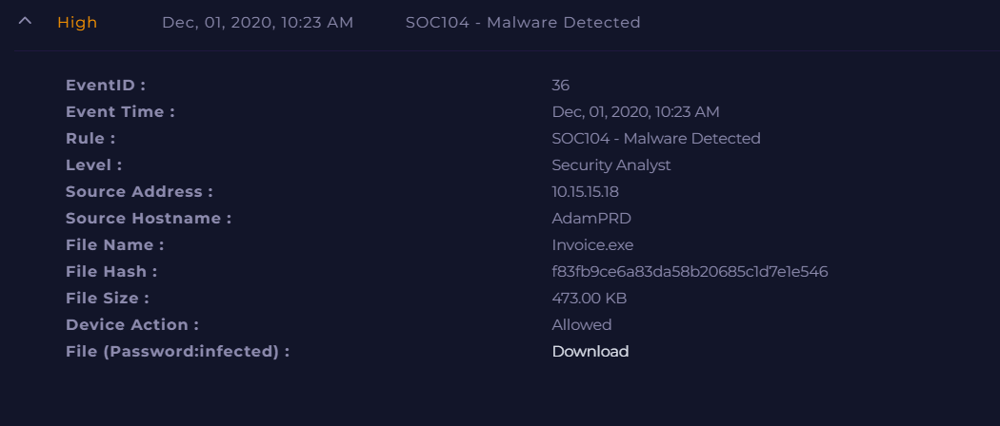
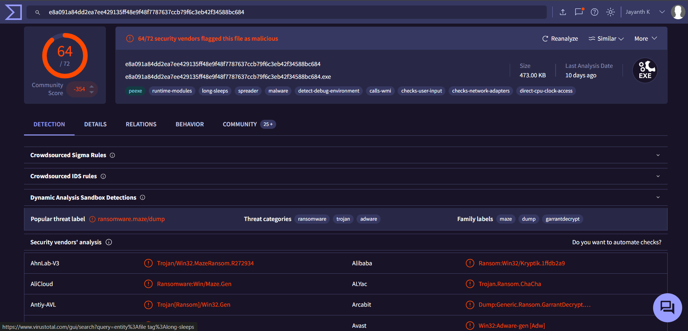

# Investigation report — SOC104 - Malware Detected

**Documentation author:** Jayanth K  
**Documentation updated:** 13 October 2026 (Asia/Calcutta)  
**Platform:** LetsDefend  
**Category:** malware-analysis  
**Case ID:** SOC104  
**Status:** Documentation organized; personal lab execution not verified

[Case overview](../README.md) · [Analyst note](../analyst-note.md) · [Evidence index](../evidence-index.md)

## Objective and scope

Organize the existing case narrative and its available screenshots for review. Technical claims in the narrative have not been independently validated against Jayanth K's original lab logs in this workspace.

## Existing investigation narrative

### 🔍 Detailed Investigation Report - SOC104 Malware Detected

#### 1. Alert Summary
A malware alert was triggered for a suspicious executable file (**Invoice.exe**) on the endpoint **AdamPRD (10.15.15.18)**. The file was allowed to execute, requiring further investigation.

---

#### 2. File Analysis

- **File Name:** Invoice.exe  
- **File Hash:** f83fb9ce6a83da58b20685c1d7e1e546  
- **File Size:** 473 KB  

##### 🔎 VirusTotal Results:
- Detected by **64 out of 72 vendors**
- Classified as **high-confidence malware**

➡️ This confirms the file is malicious.

---

#### 3. Network (Log) Analysis

- **Source IP:** 10.15.15.18  
- **Destination (C2) IP:** 92.63.8.47  
- **URL Accessed:** http://92.63.8.47/

##### 🚨 Findings:
- The infected host attempted communication with a known **Command and Control (C2) server**
- Indicates possible malware execution and external control attempt

---

#### 4. Endpoint Analysis

- **Hostname:** AdamPRD  
- Malware execution confirmed via:
  - Presence of malicious file
  - Outbound C2 communication

##### 🛑 Action Taken:
- Host was **isolated/contained** from the network to prevent lateral movement

---

#### 5. Impact Assessment

- Potential risks:
  - Data exfiltration
  - Remote command execution
  - Persistence mechanisms

- No further spread observed after containment

---

#### 6. Final Verdict

✅ **True Positive**

The file **Invoice.exe** is confirmed malware based on:
- High VirusTotal detection rate
- Confirmed communication with C2 infrastructure
- Suspicious endpoint activity

---

#### 7. Recommendations

- Perform **full system remediation (nuke & reimage if required)**
- Reset credentials associated with the affected host
- Block C2 IP (**92.63.8.47**) at firewall level
- Conduct threat hunting for similar indicators across the network
- Improve endpoint protection to prevent execution of unknown binaries

---

## Constraints and limitations

- Personal lab execution date: **Not recorded**.
- Original raw logs from that execution: **Not recorded**.
- Personally captured screenshot provenance: **Not recorded**.
- Independent confirmation of verdict and response actions: **Not recorded**.
- Original event timestamps are retained. Their presence is not a documentation update date or proof of recent execution.
- Screenshot account names may have been personalized; identity labels are not execution evidence.

## Evidence register

| Evidence ID | File | Visible content category | Image treatment |
|---|---|---|---|
| E01 | [hybrid-analysis.png](../screenshots/hybrid-analysis.png) | Hybrid Analysis result view | Existing image; no additional image edits |
| E02 | [siem-alert.png](../screenshots/siem-alert.png) | SIEM alert view | Existing image; no additional image edits |
| E03 | [virustotal.png](../screenshots/virustotal.png) | VirusTotal result view | Account-name area personalized; pixels outside that area verified unchanged |

## Screenshot evidence

### E01 — Hybrid Analysis result view

*File: `hybrid-analysis.png`. Existing image; no additional image edits. Personal capture date and original log provenance: Not recorded.*

### E02 — SIEM alert view

*File: `siem-alert.png`. Existing image; no additional image edits. Personal capture date and original log provenance: Not recorded.*

### E03 — VirusTotal result view

*File: `virustotal.png`. Account-name area personalized; pixels outside that area verified unchanged. Personal capture date and original log provenance: Not recorded.*

## Documentation closure

The case documents and available images are organized and linked. Live-lab verification remains open until original logs and capture provenance are supplied. No new containment or remediation action is asserted by this documentation update.
