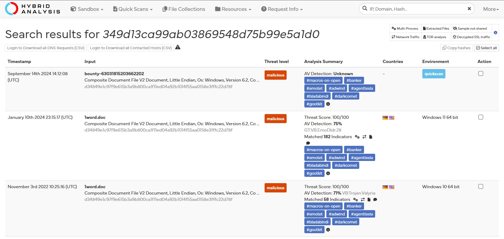
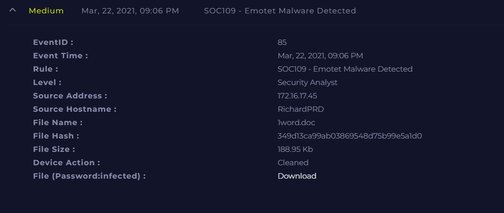
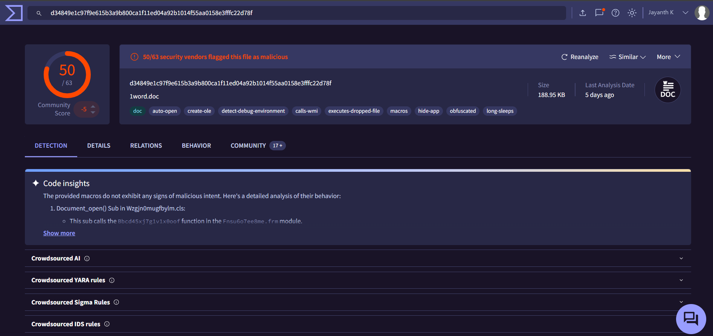
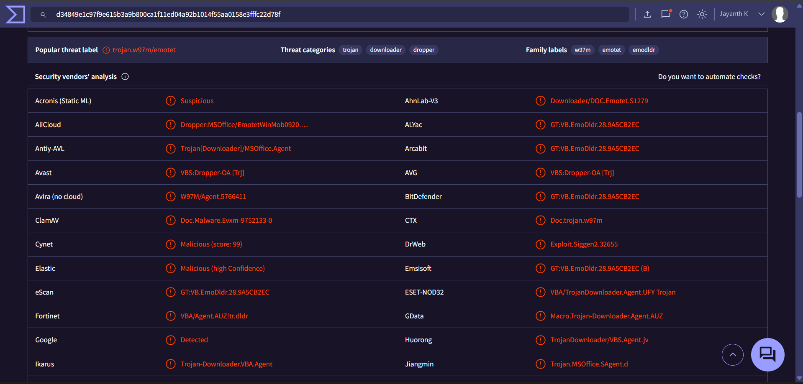

# Investigation report — SOC109 - Emotet Malware Detected

**Documentation author:** Jayanth K  
**Documentation updated:** 13 October 2026 (Asia/Calcutta)  
**Platform:** LetsDefend  
**Category:** malware-analysis  
**Case ID:** SOC109  
**Status:** Documentation organized; personal lab execution not verified

[Case overview](../README.md) · [Analyst note](../analyst-note.md) · [Evidence index](../evidence-index.md)

## Objective and scope

Organize the existing case narrative and its available screenshots for review. Technical claims in the narrative have not been independently validated against Jayanth K's original lab logs in this workspace.

## Existing investigation narrative

### 🔎 SOC109 - Emotet Malware Analysis

#### 1. Initial Detection
An alert was triggered for Emotet malware on endpoint **RichardPRD (172.16.17.45)** involving a suspicious Word document (`1word.doc`).

---

#### 2. File Analysis
- **File Name:** 1word.doc
- **MD5 Hash:** 349d13ca99ab03869548d75b99e5a1d0
- **Size:** 188.95 KB

##### Findings:
- Detected by **50/63 antivirus engines** on VirusTotal
- Classified as **Trojan.W97M/Emotet**
- Hybrid Analysis confirms malicious behavior

👉 Conclusion: File is highly malicious and associated with Emotet campaign.

---

#### 3. Behavioral Analysis
The document attempted to execute a malicious process:

- **Process:** EQNEDT32.EXE (Equation Editor exploit)
- **Parent Process:** excel.exe
- **Parent MD5:** 8b88ebbb05a0e56b7dcc708498c02b3e

##### Activity Observed:
- Initiated outbound connection to: http://andaluciabeach.net/image/network.exe
- HTTP Method: GET
- Action: Allowed

👉 This indicates macro-based exploitation leveraging Equation Editor to download payload.

---

#### 4. Network Analysis
- Malicious URL flagged by **14/91 vendors**
- URL used to download secondary payload (network.exe)

👉 Confirms Emotet’s typical behavior:
- Initial infection via maldoc
- Secondary payload download

---

#### 5. Impact Assessment
- Malware **cleaned before execution**
- Endpoint **successfully contained**
- No evidence of persistence or lateral movement

👉 Infection attempt was blocked early in the attack chain.

---

#### 6. MITRE ATT&CK Mapping
- T1566.001 – Phishing: Spearphishing Attachment
- T1203 – Exploitation for Client Execution
- T1059 – Command and Scripting Interpreter
- T1105 – Ingress Tool Transfer

---

#### 7. Response Actions
- Endpoint isolation (RichardPRD)
- Malicious file removed
- URL/domain flagged and blocked
- Investigation completed

---

#### 8. Recommendations
- Disable Microsoft Office macros from untrusted sources
- Patch/remove legacy Equation Editor (EQNEDT32.EXE)
- Implement email attachment sandboxing
- Strengthen endpoint detection rules

---

#### ✅ Final Verdict
**True Positive – Emotet Malware Attempt (Blocked Before Execution)**

## Constraints and limitations

- Personal lab execution date: **Not recorded**.
- Original raw logs from that execution: **Not recorded**.
- Personally captured screenshot provenance: **Not recorded**.
- Independent confirmation of verdict and response actions: **Not recorded**.
- Original event timestamps are retained. Their presence is not a documentation update date or proof of recent execution.
- Screenshot account names may have been personalized; identity labels are not execution evidence.

## Evidence register

| Evidence ID | File | Visible content category | Image treatment |
|---|---|---|---|
| E01 | [hybrid-analysis.png](../screenshots/hybrid-analysis.png) | Hybrid Analysis result view | Existing image; no additional image edits |
| E02 | [siem-alert.png](../screenshots/siem-alert.png) | SIEM alert view | Existing image; no additional image edits |
| E03 | [virustotal1.png](../screenshots/virustotal1.png) | VirusTotal result view | Account-name area personalized; pixels outside that area verified unchanged |
| E04 | [virustotal2.png](../screenshots/virustotal2.png) | VirusTotal result view | Account-name area personalized; pixels outside that area verified unchanged |

## Screenshot evidence

### E01 — Hybrid Analysis result view

*File: `hybrid-analysis.png`. Existing image; no additional image edits. Personal capture date and original log provenance: Not recorded.*

### E02 — SIEM alert view

*File: `siem-alert.png`. Existing image; no additional image edits. Personal capture date and original log provenance: Not recorded.*

### E03 — VirusTotal result view

*File: `virustotal1.png`. Account-name area personalized; pixels outside that area verified unchanged. Personal capture date and original log provenance: Not recorded.*

### E04 — VirusTotal result view

*File: `virustotal2.png`. Account-name area personalized; pixels outside that area verified unchanged. Personal capture date and original log provenance: Not recorded.*

## Documentation closure

The case documents and available images are organized and linked. Live-lab verification remains open until original logs and capture provenance are supplied. No new containment or remediation action is asserted by this documentation update.
