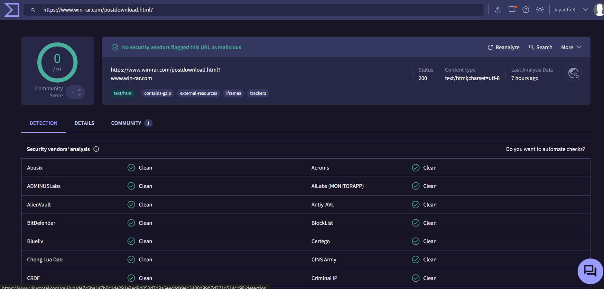

# Investigation report — SOC119 - Proxy - Malicious Executable File Detected

**Documentation author:** Jayanth K  
**Documentation updated:** 13 October 2026 (Asia/Calcutta)  
**Platform:** LetsDefend  
**Category:** malware-analysis  
**Case ID:** SOC119  
**Status:** Documentation organized; personal lab execution not verified

[Case overview](../README.md) · [Analyst note](../analyst-note.md) · [Evidence index](../evidence-index.md)

## Objective and scope

Organize the existing case narrative and its available screenshots for review. Technical claims in the narrative have not been independently validated against Jayanth K's original lab logs in this workspace.

## Existing investigation narrative

### SOC119 - Proxy - Malicious Executable File Detected

#### 📌 Alert Summary
A proxy alert was triggered due to an executable file download from win-rar.com by user Susie.

#### 🔍 Investigation Steps

##### 1. URL Analysis
- URL: https://www.win-rar.com/postdownload.html?&L=0&Version=32bit
- Domain Reputation: Legitimate (Official WinRAR site)
- VirusTotal: No detections

##### 2. File Analysis
- File Type: Executable (.exe installer)
- Expected Behavior: WinRAR installation package
- Recommendation: Verify file hash and digital signature (RARLAB)

##### 3. User Activity
- Username: Susie
- Browser: Chrome on Windows
- Action: Likely manual download

##### 4. Network Behavior
- No suspicious redirection observed
- No malicious IP reputation linked to destination

##### 5. Risk Assessment
- Executable downloads are flagged by policy
- No indicators of compromise found

#### ✅ Final Verdict
Benign activity – legitimate software download from official source.

#### 🛡️ Recommendations
- Enforce application allowlisting
- Monitor executable downloads via proxy
- Educate users on downloading software only from official sources

## Constraints and limitations

- Personal lab execution date: **Not recorded**.
- Original raw logs from that execution: **Not recorded**.
- Personally captured screenshot provenance: **Not recorded**.
- Independent confirmation of verdict and response actions: **Not recorded**.
- Original event timestamps are retained. Their presence is not a documentation update date or proof of recent execution.
- Screenshot account names may have been personalized; identity labels are not execution evidence.

## Evidence register

| Evidence ID | File | Visible content category | Image treatment |
|---|---|---|---|
| E01 | [siem-alert.png](../screenshots/siem-alert.png) | SIEM alert view | Existing image; no additional image edits |
| E02 | [virustotal.png](../screenshots/virustotal.png) | VirusTotal result view | Account-name area personalized; pixels outside that area verified unchanged |

## Screenshot evidence

### E01 — SIEM alert view

*File: `siem-alert.png`. Existing image; no additional image edits. Personal capture date and original log provenance: Not recorded.*

### E02 — VirusTotal result view

*File: `virustotal.png`. Account-name area personalized; pixels outside that area verified unchanged. Personal capture date and original log provenance: Not recorded.*

## Documentation closure

The case documents and available images are organized and linked. Live-lab verification remains open until original logs and capture provenance are supplied. No new containment or remediation action is asserted by this documentation update.
