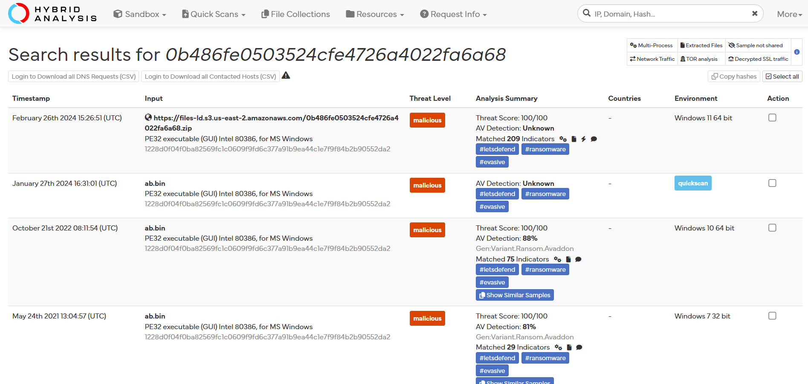
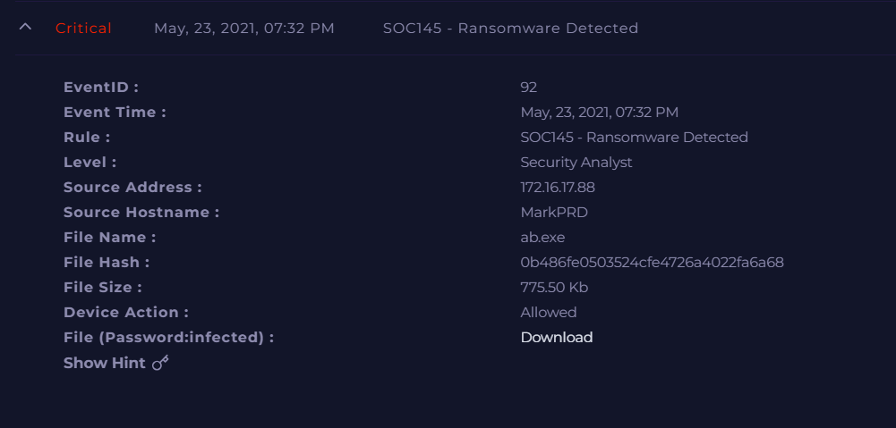
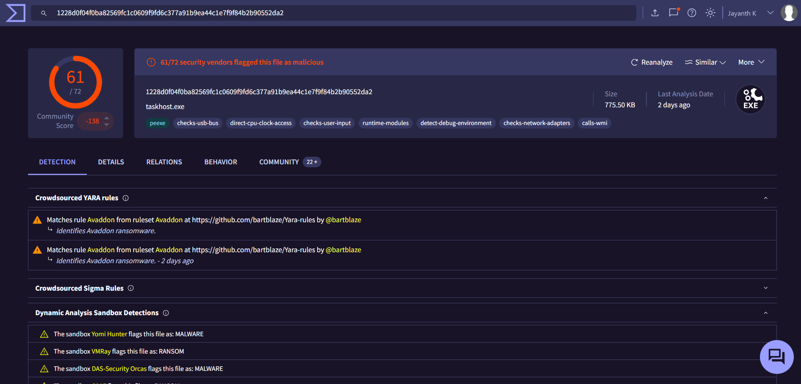

# Investigation report — SOC145 - Ransomware Detected (Avaddon)

**Documentation author:** Jayanth K  
**Documentation updated:** 13 October 2026 (Asia/Calcutta)  
**Platform:** LetsDefend  
**Category:** malware-analysis  
**Case ID:** SOC145  
**Status:** Documentation organized; personal lab execution not verified

[Case overview](../README.md) · [Analyst note](../analyst-note.md) · [Evidence index](../evidence-index.md)

## Objective and scope

Organize the existing case narrative and its available screenshots for review. Technical claims in the narrative have not been independently validated against Jayanth K's original lab logs in this workspace.

## Existing investigation narrative

### 🔍 SOC145 - Ransomware Investigation Report

#### 1. Initial Alert Review
An alert (Event ID: 92) was triggered indicating ransomware detection on host **MarkPRD**. The suspicious file `ab.exe` was allowed to execute on the system.

---

#### 2. File Analysis

- **File Name:** ab.exe  
- **Hash (MD5):** 0b486fe0503524cfe4726a4022fa6a68  
- **Size:** 775.50 KB  

##### Threat Intelligence Results:
- **VirusTotal:** 61/72 detections → Highly malicious  
- **Hybrid Analysis:** Confirmed ransomware behavior  
- **Family Identified:** Avaddon Ransomware  

➡️ Conclusion: File is confirmed malicious and linked to ransomware activity.

---

#### 3. Endpoint Analysis

- Host: **MarkPRD**
- IP Address: 172.16.17.88

##### Observations:
- The file `ab.exe` was successfully executed on the endpoint
- Process activity confirms execution of ransomware payload
- Host was contained after detection to prevent spread

➡️ Conclusion: Endpoint compromise confirmed.

---

#### 4. Behavior Analysis (Avaddon)

- Encrypts files and appends extensions
- Drops ransom note demanding cryptocurrency payment
- May attempt to disable security tools
- Known for double extortion (encryption + data leak threats)

---

#### 5. Scope & Impact

- Affected System: MarkPRD  
- Potential Risks:
  - File encryption
  - Data loss
  - Possible lateral movement
  - Credential compromise

---

#### 6. Mitigation & Response

- ✅ Endpoint isolated from network  
- ✅ Malicious process terminated  
- ✅ Indicators of Compromise identified  
- 🔄 Recommended system reimage  
- 🔄 Backup restoration required  
- 🔄 Password reset for affected user  

---

#### 7. Final Verdict

**✔ True Positive – Avaddon Ransomware Infection Confirmed**

---

#### 8. Lessons Learned

- Strengthen endpoint protection policies
- Block execution of unknown binaries
- Improve user awareness against suspicious downloads
- Ensure regular backup and recovery testing

## Constraints and limitations

- Personal lab execution date: **Not recorded**.
- Original raw logs from that execution: **Not recorded**.
- Personally captured screenshot provenance: **Not recorded**.
- Independent confirmation of verdict and response actions: **Not recorded**.
- Original event timestamps are retained. Their presence is not a documentation update date or proof of recent execution.
- Screenshot account names may have been personalized; identity labels are not execution evidence.

## Evidence register

| Evidence ID | File | Visible content category | Image treatment |
|---|---|---|---|
| E01 | [hybrid-analysis.png](../screenshots/hybrid-analysis.png) | Hybrid Analysis result view | Existing image; no additional image edits |
| E02 | [siem-alert.png](../screenshots/siem-alert.png) | SIEM alert view | Existing image; no additional image edits |
| E03 | [virustotal.png](../screenshots/virustotal.png) | VirusTotal result view | Account-name area personalized; pixels outside that area verified unchanged |

## Screenshot evidence

### E01 — Hybrid Analysis result view

*File: `hybrid-analysis.png`. Existing image; no additional image edits. Personal capture date and original log provenance: Not recorded.*

### E02 — SIEM alert view

*File: `siem-alert.png`. Existing image; no additional image edits. Personal capture date and original log provenance: Not recorded.*

### E03 — VirusTotal result view

*File: `virustotal.png`. Account-name area personalized; pixels outside that area verified unchanged. Personal capture date and original log provenance: Not recorded.*

## Documentation closure

The case documents and available images are organized and linked. Live-lab verification remains open until original logs and capture provenance are supplied. No new containment or remediation action is asserted by this documentation update.
