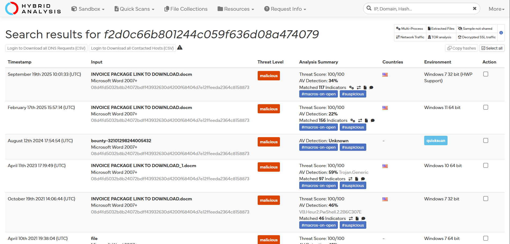
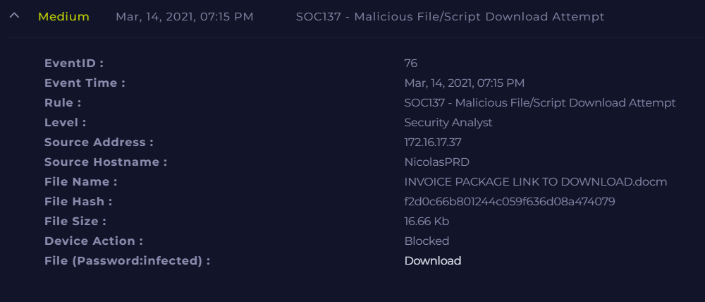
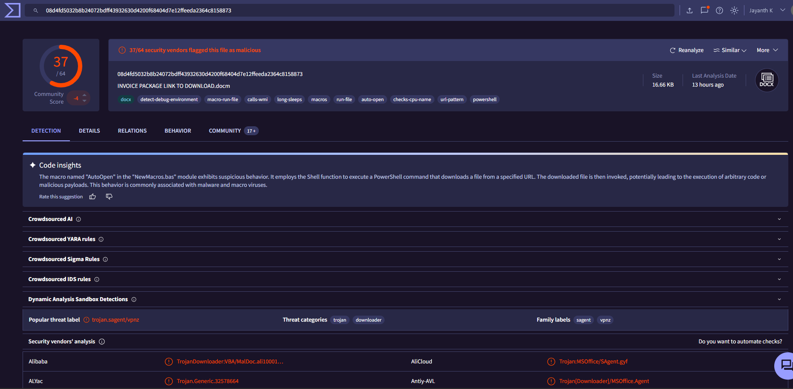

# Investigation report — SOC137 - Malicious File/Script Download Attempt

**Documentation author:** Jayanth K  
**Documentation updated:** 13 October 2026 (Asia/Calcutta)  
**Platform:** LetsDefend  
**Category:** malicious-file-analysis  
**Case ID:** SOC137  
**Status:** Documentation organized; personal lab execution not verified

[Case overview](../README.md) · [Analyst note](../analyst-note.md) · [Evidence index](../evidence-index.md)

## Objective and scope

Organize the existing case narrative and its available screenshots for review. Technical claims in the narrative have not been independently validated against Jayanth K's original lab logs in this workspace.

## Existing investigation narrative

### Investigation Report - SOC137 Alert

#### 🧠 Alert Description
The SOC137 alert indicates an attempt to download a malicious file or script. The file involved is a macro-enabled Word document, often used in phishing attacks to execute malicious code.

---

#### 📂 File Analysis

- **File Name:** INVOICE PACKAGE LINK TO DOWNLOAD.docm  
- **Hash (MD5):** f2d0c66b801244c059f636d08a474079  

##### 🔎 VirusTotal Results
- **Detection Ratio:** 37 / 64 vendors flagged as malicious  
- **Threat Label:** trojan.sagent / vpnz  

##### 📌 Observations
- The file is a **.docm (macro-enabled document)**, indicating potential macro execution.
- Common tactic: trick user into enabling macros → execute payload.
- Likely delivered via phishing email disguised as invoice-related content.

---

#### 💻 Endpoint Analysis

- No communication with Command & Control (C2) servers detected.
- Indicates:
  - File execution likely prevented, OR
  - Infection stopped at early stage.

---

#### 🚫 Security Control Actions

- **File download was blocked** by security controls.
- No further spread or lateral movement observed.

---

#### ⚠️ Threat Assessment

| Indicator              | Status         |
|----------------------|---------------|
| Malicious File       | ✅ Confirmed   |
| Execution            | ❌ Prevented   |
| C2 Communication     | ❌ Not observed|
| Lateral Movement     | ❌ Not observed|

---

#### 🧾 Conclusion

This alert is a **True Positive**.  
The file is confirmed malicious and matches known trojan signatures. Security controls effectively prevented execution and potential compromise.

---

#### 🔐 Recommendations

1. Disable macros in Microsoft Office by default.
2. Implement email filtering for suspicious attachments.
3. Conduct user awareness training on phishing attacks.
4. Monitor endpoints for similar indicators (hash, filename).
5. Use sandboxing for suspicious file analysis.

---

#### 📌 MITRE ATT&CK Mapping

- **T1566.001** – Phishing: Spearphishing Attachment  
- **T1204.002** – User Execution: Malicious File  
- **T1059.005** – Command Execution via Macros  

---

## Constraints and limitations

- Personal lab execution date: **Not recorded**.
- Original raw logs from that execution: **Not recorded**.
- Personally captured screenshot provenance: **Not recorded**.
- Independent confirmation of verdict and response actions: **Not recorded**.
- Original event timestamps are retained. Their presence is not a documentation update date or proof of recent execution.
- Screenshot account names may have been personalized; identity labels are not execution evidence.

## Evidence register

| Evidence ID | File | Visible content category | Image treatment |
|---|---|---|---|
| E01 | [hybrid-analysis-report.png](../screenshots/hybrid-analysis-report.png) | Hybrid Analysis result view | Existing image; no additional image edits |
| E02 | [siem-alert.png](../screenshots/siem-alert.png) | SIEM alert view | Existing image; no additional image edits |
| E03 | [virustotal-report.png](../screenshots/virustotal-report.png) | VirusTotal result view | Account-name area personalized; pixels outside that area verified unchanged |

## Screenshot evidence

### E01 — Hybrid Analysis result view

*File: `hybrid-analysis-report.png`. Existing image; no additional image edits. Personal capture date and original log provenance: Not recorded.*

### E02 — SIEM alert view

*File: `siem-alert.png`. Existing image; no additional image edits. Personal capture date and original log provenance: Not recorded.*

### E03 — VirusTotal result view

*File: `virustotal-report.png`. Account-name area personalized; pixels outside that area verified unchanged. Personal capture date and original log provenance: Not recorded.*

## Documentation closure

The case documents and available images are organized and linked. Live-lab verification remains open until original logs and capture provenance are supplied. No new containment or remediation action is asserted by this documentation update.
