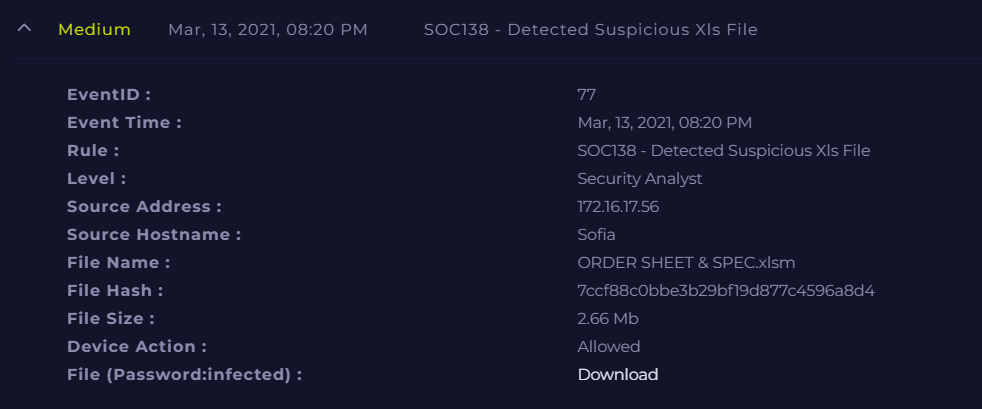

# SOC138 - Suspicious XLS File Detection

**Documentation author:** Jayanth K  
**Documentation updated:** 13 October 2026 (Asia/Calcutta)  
**Platform:** LetsDefend  
**Category:** malicious-file-analysis  
**Case ID:** SOC138  
**Documentation status:** Completed
**Lab execution verification:** Not recorded

[Platform index](../../README.md) · [Category index](../README.md) · [Portfolio home](../../../README.md)

## Screenshot preview

[View all screenshots in the report](reports/investigation.md#screenshot-evidence) · [Open this image at full resolution](https://raw.githubusercontent.com/karrijayanth65/SOC-Investigations/refs/heads/main/LetsDefend/malicious-file-analysis/SOC138-Detected-Suspicious-Xls-File/screenshots/siem-alert.png)

*Existing SIEM alert image: `siem-alert.png`. Open the full-resolution image and click it to enlarge small text. Image treatment and provenance are recorded in the [evidence index](evidence-index.md).*

## Case overview

### Overview
This case involves the detection of a suspicious Excel macro-enabled file (`.xlsm`) executed on an endpoint. The activity triggered a SOC alert due to potential malicious behavior.

### Alert Details
- **Event ID:** 77  
- **Rule:** SOC138 - Detected Suspicious Xls File  
- **Severity:** Security Analyst  
- **Timestamp:** Mar 13, 2021, 08:20 PM  

### Affected Host
- **Hostname:** Sofia  
- **IP Address:** 172.16.17.56  

### File Information
- **File Name:** ORDER SHEET & SPEC.xlsm  
- **File Hash:** 7ccf88c0bbe3b29bf19d877c4596a8d4  
- **File Size:** 2.66 MB  
- **Device Action:** Allowed  

### Summary
A macro-enabled Excel file was executed on the host Sofia. The file exhibited malicious behavior, including initiating outbound communication to a known malicious IP address.

### Verdict
**True Positive** – Confirmed malicious document leading to system compromise.

### Actions Taken
- Endpoint containment performed
- Malicious file analyzed and confirmed
- Network communication reviewed

### Recommendation
- Block malicious IP and hash across the network
- Disable macros by default in Office applications
- Conduct user awareness training on phishing and malicious attachments

## Documents and evidence

- [Detailed investigation](reports/investigation.md)
- [Analyst note](analyst-note.md)
- [Evidence index and missing information](evidence-index.md)
- [Screenshots folder](screenshots/)

## Evidence status

3 existing screenshots are linked from the report. Personal execution date, original logs for that execution, and independent validation are **Not recorded**. Preserve the original event timestamps in the narrative. Account-name personalization does not establish who performed the lab.
