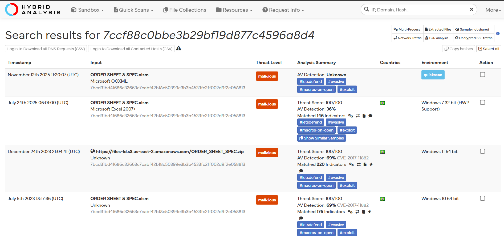
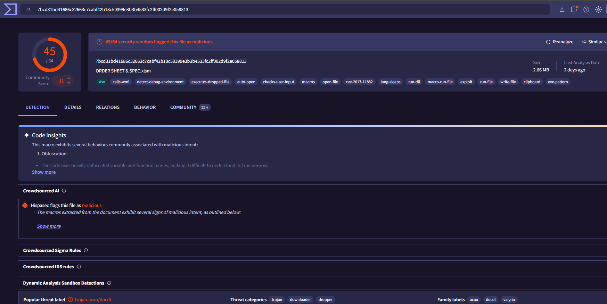

# Investigation report — SOC138 - Suspicious XLS File Detection

**Documentation author:** Jayanth K  
**Documentation updated:** 13 October 2026 (Asia/Calcutta)  
**Platform:** LetsDefend  
**Category:** malicious-file-analysis  
**Case ID:** SOC138  
**Status:** Documentation organized; personal lab execution not verified

[Case overview](../README.md) · [Analyst note](../analyst-note.md) · [Evidence index](../evidence-index.md)

## Objective and scope

Organize the existing case narrative and its available screenshots for review. Technical claims in the narrative have not been independently validated against Jayanth K's original lab logs in this workspace.

## Existing investigation narrative

### Investigation Report - SOC138 Suspicious XLS File

#### 1. Alert Trigger
An alert (Event ID: 77) was triggered indicating the execution of a suspicious Excel macro-enabled file on endpoint Sofia (172.16.17.56).

#### 2. Initial Findings
- The file `ORDER SHEET & SPEC.xlsm` was executed by the user.
- The file was allowed by the system at the time of execution.
- Macro-enabled Excel files are commonly used to deliver malware.

#### 3. File Hash Analysis
- **Hash:** 7ccf88c0bbe3b29bf19d877c4596a8d4  
- **VirusTotal Detection:** 45/64 vendors flagged as malicious  
- **Threat Label:** Trojan.acao/docdl  

This confirms the file is highly suspicious and widely recognized as malicious.

#### 4. Network Activity Analysis
- The infected host initiated multiple HTTP requests to:
  - **Malicious IP:** 177.53.143.89  
- The communication occurred immediately after file execution.
- This behavior is consistent with Command and Control (C2) communication.

#### 5. Endpoint Analysis
- Host Sofia (172.16.17.56) showed signs of compromise.
- The system was successfully contained to prevent lateral movement.
- No additional suspicious processes were reported beyond initial execution.

#### 6. Attack Flow
1. User executed malicious Excel file  
2. Macro payload triggered  
3. Outbound connection to C2 server established  
4. System compromise confirmed  

#### 7. Conclusion
The alert represents a **True Positive**. The Excel file was malicious and led to active communication with a known malicious IP, confirming compromise.

#### 8. Mitigation Steps
- Isolated affected endpoint
- Blocked malicious IP (177.53.143.89)
- Added file hash to blocklist
- Recommended macro restrictions in Office applications

#### 9. Recommendations
- Enforce email attachment scanning
- Disable macros unless explicitly needed
- Deploy endpoint detection and response (EDR)
- Conduct phishing awareness training for users

## Constraints and limitations

- Personal lab execution date: **Not recorded**.
- Original raw logs from that execution: **Not recorded**.
- Personally captured screenshot provenance: **Not recorded**.
- Independent confirmation of verdict and response actions: **Not recorded**.
- Original event timestamps are retained. Their presence is not a documentation update date or proof of recent execution.
- Screenshot account names may have been personalized; identity labels are not execution evidence.

## Evidence register

| Evidence ID | File | Visible content category | Image treatment |
|---|---|---|---|
| E01 | [hybrid-analysis-report.png](../screenshots/hybrid-analysis-report.png) | Hybrid Analysis result view | Existing image; no additional image edits |
| E02 | [siem-alert.png](../screenshots/siem-alert.png) | SIEM alert view | Existing image; no additional image edits |
| E03 | [virustotal-report.png](../screenshots/virustotal-report.png) | VirusTotal result view | Existing image; no additional image edits |

## Screenshot evidence

### E01 — Hybrid Analysis result view

*File: `hybrid-analysis-report.png`. Existing image; no additional image edits. Personal capture date and original log provenance: Not recorded.*

### E02 — SIEM alert view

*File: `siem-alert.png`. Existing image; no additional image edits. Personal capture date and original log provenance: Not recorded.*

### E03 — VirusTotal result view

*File: `virustotal-report.png`. Existing image; no additional image edits. Personal capture date and original log provenance: Not recorded.*

## Documentation closure

The case documents and available images are organized and linked. Live-lab verification remains open until original logs and capture provenance are supplied. No new containment or remediation action is asserted by this documentation update.
