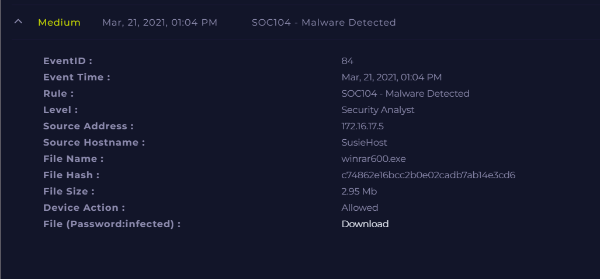

# SOC104 - Malware Detected (False Positive)

**Documentation author:** Jayanth K  
**Documentation updated:** 13 October 2026 (Asia/Calcutta)  
**Platform:** LetsDefend  
**Category:** malware-analysis  
**Case ID:** SOC104  
**Documentation status:** Completed
**Lab execution verification:** Not recorded

[Platform index](../../README.md) · [Category index](../README.md) · [Portfolio home](../../../README.md)

## Screenshot preview

[View all screenshots in the report](reports/investigation.md#screenshot-evidence) · [Open this image at full resolution](screenshots/siem-alert.png?raw=true)

*Existing SIEM alert image: `siem-alert.png`. Open the full-resolution image and click it to enlarge small text. Image treatment and provenance are recorded in the [evidence index](evidence-index.md).*

## Case overview

### 📖 Overview
This alert was triggered when a file named **winrar600.exe** was downloaded on the host system *SusieHost*. The detection rule flagged the file as potential malware.

---

### 🚨 Alert Details

- **Event ID:** 84  
- **Date & Time:** Mar 21, 2021 – 01:04 PM  
- **Rule:** SOC104 - Malware Detected  
- **Source Host:** SusieHost  
- **Source IP:** 172.16.17.5  
- **File Name:** winrar600.exe  
- **File Hash:** c74862e16bcc2b0e02cadb7ab14e3cd6  
- **File Size:** 2.95 MB  
- **Action Taken:** Allowed  

---

### 🔍 Summary of Findings

- File hash checked on VirusTotal → **1/72 detections**
- Download source verified → **Official WinRAR website**
- Associated IP (51.195.68.163) → **Clean**
- No suspicious behavior observed

---

### ✅ Final Verdict

**False Positive**

The file is a legitimate installer for WinRAR downloaded from the vendor’s official website.

---

### 🛡️ Recommendations

- No remediation required
- Continue monitoring for unusual downloads
- Consider allowlisting trusted vendor sources

## Documents and evidence

- [Detailed investigation](reports/investigation.md)
- [Analyst note](analyst-note.md)
- [Evidence index and missing information](evidence-index.md)
- [Screenshots folder](screenshots/)

## Evidence status

3 existing screenshots are linked from the report. Personal execution date, original logs for that execution, and independent validation are **Not recorded**. Preserve the original event timestamps in the narrative. Account-name personalization does not establish who performed the lab.
