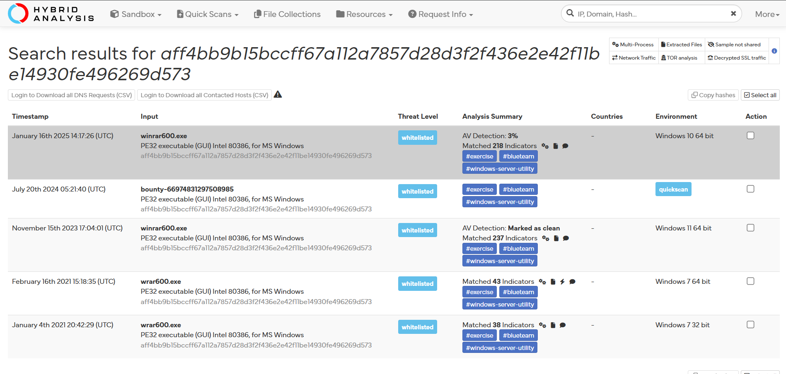
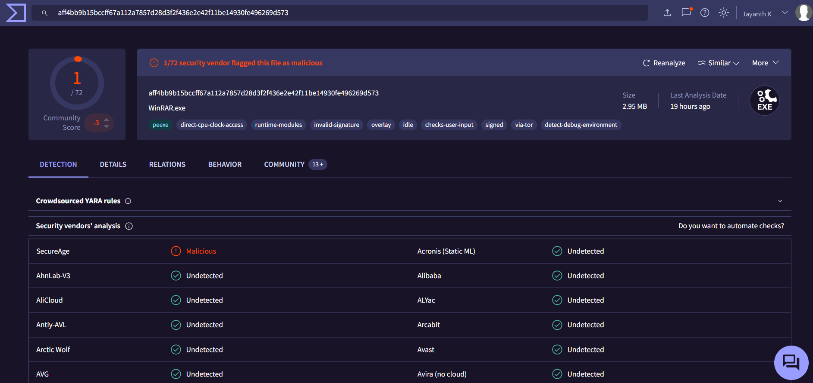

# Investigation report — SOC104 - Malware Detected (False Positive)

**Documentation author:** Jayanth K  
**Documentation updated:** 13 October 2026 (Asia/Calcutta)  
**Platform:** LetsDefend  
**Category:** malware-analysis  
**Case ID:** SOC104  
**Documentation status:** Completed
**Lab execution verification:** Not recorded

[Case overview](../README.md) · [Analyst note](../analyst-note.md) · [Evidence index](../evidence-index.md)

## Objective and scope

Organize the existing case narrative and its available screenshots for review. Technical claims in the narrative have not been independently validated against Jayanth K's original lab logs in this workspace.

## Existing investigation narrative

### 🔬 Detailed Investigation – SOC104 Malware Detected

#### 📌 Incident Summary

An alert was generated indicating possible malware detection on host **SusieHost** after downloading a file named **winrar600.exe**.

---

#### 🧾 Step 1: Initial Alert Review

- Detection triggered under rule: **SOC104 - Malware Detected**
- File was allowed by the system
- File size and naming appeared consistent with legitimate software

---

#### 🔎 Step 2: Hash Analysis

- File hash: `c74862e16bcc2b0e02cadb7ab14e3cd6`
- Checked on VirusTotal:
  - Result: **1/72 engines flagged**
  - Interpretation: Likely false positive detection

---

#### 🌐 Step 3: Source Verification

- Download URL:
  https://www.win-rar.com/postdownload.html?&L=0&Version=32bit
- Verified as official vendor website
- No signs of phishing or spoofing

---

#### 🌍 Step 4: IP Reputation Check

- IP Address: **51.195.68.163**
- Checked via threat intelligence sources
- Result: **Clean / No malicious reputation**

---

#### 🧠 Step 5: Behavioral Analysis

- No abnormal execution behavior observed
- No persistence mechanisms detected
- No suspicious network activity post-download

---

#### ⚖️ Conclusion

All indicators confirm that:

- The file is legitimate
- Source is trusted
- Detection was likely heuristic or false flag

---

#### ✅ Final Verdict

**False Positive**

---

#### 🛡️ Recommendations

- Allowlist official WinRAR download domains
- Tune detection rules to reduce false positives
- Continue monitoring endpoint activity for anomalies

## Constraints and limitations

- Personal lab execution date: **Not recorded**.
- Original raw logs from that execution: **Not recorded**.
- Personally captured screenshot provenance: **Not recorded**.
- Independent confirmation of verdict and response actions: **Not recorded**.
- Original event timestamps are retained. Their presence is not a documentation update date or proof of recent execution.
- Screenshot account names may have been personalized; identity labels are not execution evidence.

## Evidence register

| Evidence ID | File | Visible content category | Image treatment |
|---|---|---|---|
| E01 | [hybrid-analysis.png](../screenshots/hybrid-analysis.png) | Hybrid Analysis result view | Existing image; no additional image edits |
| E02 | [siem-alert.png](../screenshots/siem-alert.png) | SIEM alert view | Existing image; no additional image edits |
| E03 | [virustotal.png](../screenshots/virustotal.png) | VirusTotal result view | Account-name area personalized; pixels outside that area verified unchanged |

## Screenshot evidence

### E01 — Hybrid Analysis result view

*File: `hybrid-analysis.png`. Existing image; no additional image edits. Personal capture date and original log provenance: Not recorded.*

### E02 — SIEM alert view

*File: `siem-alert.png`. Existing image; no additional image edits. Personal capture date and original log provenance: Not recorded.*

### E03 — VirusTotal result view

*File: `virustotal.png`. Account-name area personalized; pixels outside that area verified unchanged. Personal capture date and original log provenance: Not recorded.*

## Documentation closure

The case documents and available images are organized and linked. Live-lab verification remains open until original logs and capture provenance are supplied. No new containment or remediation action is asserted by this documentation update.
