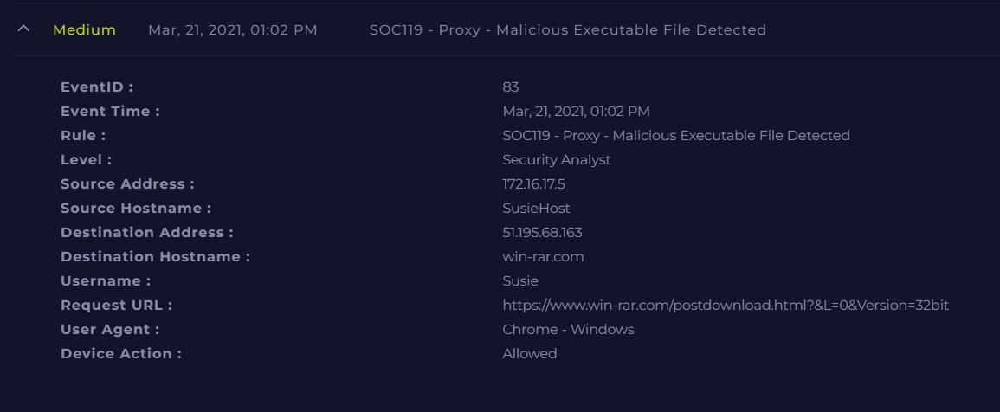

# SOC119 - Proxy - Malicious Executable File Detected

**Documentation author:** Jayanth K  
**Documentation updated:** 13 October 2026 (Asia/Calcutta)  
**Platform:** LetsDefend  
**Category:** malware-analysis  
**Case ID:** SOC119  
**Documentation status:** Completed
**Lab execution verification:** Not recorded

[Platform index](../../README.md) · [Category index](../README.md) · [Portfolio home](../../../README.md)

## Screenshot preview

[View all screenshots in the report](reports/investigation.md#screenshot-evidence) · [Open this image at full resolution](https://raw.githubusercontent.com/karrijayanth65/SOC-Investigations/refs/heads/main/LetsDefend/malware-analysis/SOC119-Proxy-Malicious-Executable-File-Detected/screenshots/siem-alert.png)

*Existing SIEM alert image: `siem-alert.png`. Open the full-resolution image and click it to enlarge small text. Image treatment and provenance are recorded in the [evidence index](evidence-index.md).*

## Case overview

### 📌 Overview

This case involves a proxy alert triggered due to the download of an executable file from an external website. The activity was initially flagged as potentially malicious based on security monitoring rules.

---

### 🚨 Alert Details

* **Event ID:** 83
* **Rule:** SOC119 - Proxy - Malicious Executable File Detected
* **Level:** Security Analyst
* **Source Host:** SusieHost (172.16.17.5)
* **User:** Susie
* **Destination IP:** 51.195.68.163
* **Domain:** win-rar.com
* **URL:** https://www.win-rar.com/postdownload.html?&L=0&Version=32bit
* **User Agent:** Chrome - Windows
* **Action:** Allowed

---

### 🔍 Investigation Summary

* The domain **win-rar.com** was verified as the official WinRAR website.
* The URL corresponds to a legitimate software download page.
* VirusTotal analysis showed no malicious detections.
* No suspicious redirection or abnormal network behavior was observed.
* Activity appears to be a **user-initiated download**.

---

### 🧠 Analysis

Executable downloads are commonly flagged by proxy/security tools because they can be used to deliver malware. However, in this case:

* The source is a trusted and official website
* No indicators of compromise (IOCs) were identified
* No malicious behavior followed the download

---

### ✅ Final Verdict

**Benign – Legitimate Software Download**

The alert was triggered due to policy rules monitoring executable downloads. No malicious activity was detected.

---

### 🛡️ Recommendations

* Monitor executable downloads through proxy logs
* Implement application allowlisting where possible
* Educate users to download software only from trusted sources
* Continue endpoint monitoring for post-download behavior

## Documents and evidence

- [Detailed investigation](reports/investigation.md)
- [Analyst note](analyst-note.md)
- [Evidence index and missing information](evidence-index.md)
- [Screenshots folder](screenshots/)

## Evidence status

2 existing screenshots are linked from the report. Personal execution date, original logs for that execution, and independent validation are **Not recorded**. Preserve the original event timestamps in the narrative. Account-name personalization does not establish who performed the lab.
