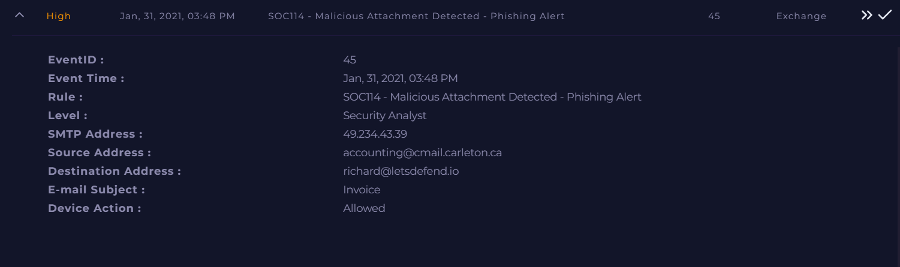

# 📧 SOC114 – Malicious Attachment Detected (Phishing Alert)

**Documentation author:** Jayanth K  
**Documentation updated:** 13 October 2026 (Asia/Calcutta)  
**Platform:** LetsDefend  
**Category:** phishing-email-analysis  
**Case ID:** SOC114  
**Documentation status:** Completed
**Lab execution verification:** Not recorded

[Platform index](../../README.md) · [Category index](../README.md) · [Portfolio home](../../../README.md)

## Screenshot preview

[View all screenshots in the report](reports/investigation.md#screenshot-evidence) · [Open this image at full resolution](screenshots/siem-alert.png?raw=true)

*Existing SIEM alert image: `siem-alert.png`. Open the full-resolution image and click it to enlarge small text. Image treatment and provenance are recorded in the [evidence index](evidence-index.md).*

## Case overview

### 📌 Overview
This alert involves a phishing email delivering a malicious attachment identified as **RemcosRAT**, exploiting a Microsoft Office vulnerability (CVE-2017-11882).

### 🧪 Scenario Details
- **Event ID:** 45  
- **Alert Rule:** SOC114 - Malicious Attachment Detected  
- **Date:** Jan 31, 2021  
- **Recipient:** richard@letsdefend.io  
- **Subject:** Invoice  

### 📎 Key Indicators
- Malicious Attachment Hash: `c9ad9506bcccfaa987ff9fc11b91698d`
- Malware: RemcosRAT
- Exploit: CVE-2017-11882
- Malicious Domain: andaluciabeach.net
- C2 IP: 70.38.21.234
- Suspicious Tool: JuicyPotato.exe

### 🚨 Impact
- Remote Access Trojan execution
- Privilege escalation activity
- Potential full system compromise

### ✅ Verdict
**True Positive**

### 🔧 Response Actions
- Isolate affected system
- Block malicious domain & IP
- Remove malware & persistence
- Reset user credentials
- Patch vulnerable software

## Documents and evidence

- [Detailed investigation](reports/investigation.md)
- [Analyst note](analyst-note.md)
- [Evidence index and missing information](evidence-index.md)
- [Screenshots folder](screenshots/)

## Evidence status

3 existing screenshots are linked from the report. Personal execution date, original logs for that execution, and independent validation are **Not recorded**. Preserve the original event timestamps in the narrative. Account-name personalization does not establish who performed the lab.
