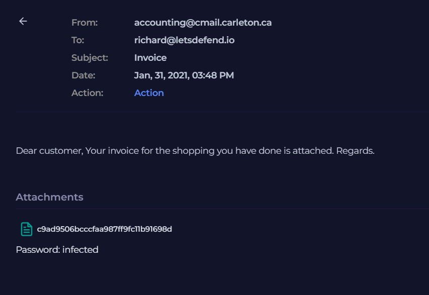
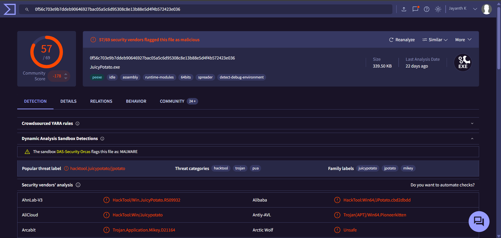

# Investigation report — 📧 SOC114 – Malicious Attachment Detected (Phishing Alert)

**Documentation author:** Jayanth K  
**Documentation updated:** 13 October 2026 (Asia/Calcutta)  
**Platform:** LetsDefend  
**Category:** phishing-email-analysis  
**Case ID:** SOC114  
**Documentation status:** Completed
**Lab execution verification:** Not recorded

[Case overview](../README.md) · [Analyst note](../analyst-note.md) · [Evidence index](../evidence-index.md)

## Objective and scope

Organize the existing case narrative and its available screenshots for review. Technical claims in the narrative have not been independently validated against Jayanth K's original lab logs in this workspace.

## Existing investigation narrative

### 🔍 Detailed Investigation Report – SOC114

#### 📌 Alert Overview
- **Event ID:** 45  
- **Rule:** SOC114 - Malicious Attachment Detected - Phishing Alert  
- **Date & Time:** Jan 31, 2021, 03:48 PM  
- **Severity Level:** Security Analyst  
- **Action Taken by Device:** Allowed  

This alert indicates that a phishing email containing a malicious attachment was successfully delivered to the user.

---

#### 📧 Email Analysis

##### Email Metadata
- **Sender:** accounting@cmail.carleton.ca  
- **Recipient:** richard@letsdefend.io  
- **SMTP IP:** 49.234.43.39  
- **Subject:** Invoice  

##### Email Content
The email impersonates a legitimate invoice notification:
> "Dear customer, Your invoice for the shopping you have done is attached."

##### Social Engineering Indicators
- Generic greeting ("Dear customer")
- Urgency implied through invoice context
- No personalization
- Suspicious external sender domain

##### Attachment Details
- **File Name / Hash:** c9ad9506bcccfaa987ff9fc11b91698d  
- **Password:** infected (commonly used to evade email security controls)

---

#### 🧪 Malware Analysis

##### Detection Results
- Flagged by **36/63** security vendors on VirusTotal  
- Identified as: **Trojan – RemcosRAT**

##### Malware Capabilities
RemcosRAT is a Remote Access Trojan capable of:
- Full remote control of the infected system
- Keylogging and credential theft
- Screen capture and surveillance
- File manipulation and persistence

##### Exploited Vulnerability
- **CVE-2017-11882**
- Microsoft Office Memory Corruption Vulnerability
- Allows remote code execution without user interaction beyond opening the file

---

#### 🌐 Network Analysis

##### Observed Activity
- **Source Host:** 172.16.17.45 (RichardPRD)
- The host communicated with a known malicious domain:
  - **Domain:** andaluciabeach.net

##### Malicious Payload Download
- URL: http://andaluciabeach.net/image/network.exe  
- Detection: 14/91 vendors flagged as malicious

##### Command & Control (C2)
- **IP Address:** 70.38.21.234  
- Indicates active attacker communication and possible data exfiltration

---

#### 🖥️ Endpoint Analysis

##### Suspicious Execution
- Process observed: **JuicyPotato.exe**

##### Detection
- Flagged by **57/69** vendors  
- Classified as: **HackTool.JuicyPotato**

##### Significance
- JuicyPotato is a known privilege escalation exploit
- Indicates attacker attempted to gain SYSTEM-level privileges
- Confirms post-exploitation activity

---

#### 🔗 Attack Chain (Kill Chain Mapping)

1. **Initial Access**  
   - Phishing email delivered with malicious attachment  

2. **Execution**  
   - User opens attachment exploiting CVE-2017-11882  

3. **Persistence & Payload Delivery**  
   - RemcosRAT installed and executed  

4. **Command & Control**  
   - Communication with C2 server (70.38.21.234)  

5. **Privilege Escalation**  
   - JuicyPotato.exe executed  

6. **Potential Impact**  
   - Full system compromise  
   - Data exfiltration  
   - Unauthorized remote access  

---

#### 🚨 Impact Assessment

- Compromise of endpoint (172.16.17.45)
- Unauthorized remote access via RAT
- Elevated privileges obtained
- Risk of credential theft and lateral movement

---

#### 🧾 Final Verdict
✅ **True Positive – Confirmed malicious phishing attack with successful exploitation and post-exploitation activity**

---

#### 🔧 Recommended Response Actions

##### Immediate Actions
- Isolate the affected endpoint from the network  
- Terminate malicious processes (RemcosRAT, JuicyPotato)  
- Block domain: andaluciabeach.net  
- Block C2 IP: 70.38.21.234  

##### Remediation
- Remove malicious files and persistence mechanisms  
- Perform full antivirus and EDR scan  
- Patch vulnerability CVE-2017-11882  
- Reset credentials for affected user  

##### Post-Incident اقدامات
- Review logs for lateral movement  
- Monitor network for similar indicators  
- Conduct user awareness training on phishing attacks  

---

## Constraints and limitations

- Personal lab execution date: **Not recorded**.
- Original raw logs from that execution: **Not recorded**.
- Personally captured screenshot provenance: **Not recorded**.
- Independent confirmation of verdict and response actions: **Not recorded**.
- Original event timestamps are retained. Their presence is not a documentation update date or proof of recent execution.
- Screenshot account names may have been personalized; identity labels are not execution evidence.

## Evidence register

| Evidence ID | File | Visible content category | Image treatment |
|---|---|---|---|
| E01 | [email.png](../screenshots/email.png) | Email content view | Existing image; no additional image edits |
| E02 | [siem-alert.png](../screenshots/siem-alert.png) | SIEM alert view | Existing image; no additional image edits |
| E03 | [virustotal-report.png](../screenshots/virustotal-report.png) | VirusTotal result view | Account-name area personalized; pixels outside that area verified unchanged |

## Screenshot evidence

### E01 — Email content view

*File: `email.png`. Existing image; no additional image edits. Personal capture date and original log provenance: Not recorded.*

### E02 — SIEM alert view

*File: `siem-alert.png`. Existing image; no additional image edits. Personal capture date and original log provenance: Not recorded.*

### E03 — VirusTotal result view

*File: `virustotal-report.png`. Account-name area personalized; pixels outside that area verified unchanged. Personal capture date and original log provenance: Not recorded.*

## Documentation closure

The case documents and available images are organized and linked. Live-lab verification remains open until original logs and capture provenance are supplied. No new containment or remediation action is asserted by this documentation update.
