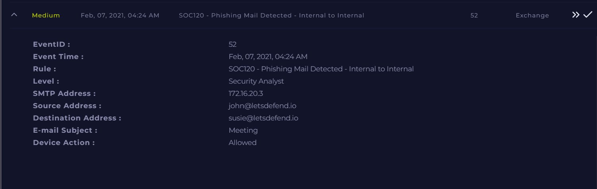

# Phishing Mail Detected – Internal to Internal (False Positive)

**Documentation author:** Jayanth K  
**Documentation updated:** 13 October 2026 (Asia/Calcutta)  
**Platform:** LetsDefend  
**Category:** phishing-email-analysis  
**Case ID:** SOC120  
**Documentation status:** Completed
**Lab execution verification:** Not recorded

[Platform index](../../README.md) · [Category index](../README.md) · [Portfolio home](../../../README.md)

## Screenshot preview

[View all screenshots in the report](reports/investigation.md#screenshot-evidence) · [Open this image at full resolution](screenshots/siem-alert.png?raw=true)

*Existing SIEM alert image: `siem-alert.png`. Open the full-resolution image and click it to enlarge small text. Image treatment and provenance are recorded in the [evidence index](evidence-index.md).*

## Case overview

### Alert Overview

- Event ID: 52
- Rule: SOC120 - Phishing Mail Detected - Internal to Internal
- SMTP Address: 172.16.20.3
- Source Email: john@letsdefend.io
- Destination Email: susie@letsdefend.io
- Subject: Meeting
- Device Action: Allowed

---

### Summary

An alert was triggered for a suspected phishing email within internal communication. Investigation confirmed that the email was a legitimate meeting-related message exchanged between internal users.

No malicious indicators were found.

---

### Key Findings

- Internal sender and recipient
- Normal subject and context
- No suspicious links or attachments
- No abnormal behavior observed

---

### Impact Assessment

- No evidence of phishing
- No security risk identified

---

### Final Verdict

False Positive – Legitimate Internal Communication

---

### Tools Used

- LetsDefend SIEM

---

### Recommendations

- No action required
- Continue monitoring email alerts

---

## Documents and evidence

- [Detailed investigation](reports/investigation.md)
- [Analyst note](analyst-note.md)
- [Evidence index and missing information](evidence-index.md)
- [Screenshots folder](screenshots/)

## Evidence status

2 existing screenshots are linked from the report. Personal execution date, original logs for that execution, and independent validation are **Not recorded**. Preserve the original event timestamps in the narrative. Account-name personalization does not establish who performed the lab.
