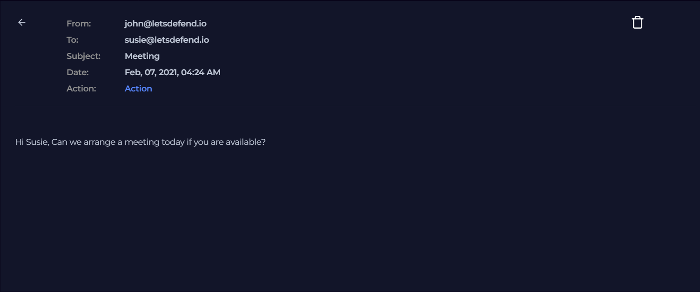

# Investigation report — Phishing Mail Detected – Internal to Internal (False Positive)

**Documentation author:** Jayanth K  
**Documentation updated:** 13 October 2026 (Asia/Calcutta)  
**Platform:** LetsDefend  
**Category:** phishing-email-analysis  
**Case ID:** SOC120  
**Documentation status:** Completed
**Lab execution verification:** Not recorded

[Case overview](../README.md) · [Analyst note](../analyst-note.md) · [Evidence index](../evidence-index.md)

## Quick navigation

[Investigation narrative](#existing-investigation-narrative) · [Evidence register](#evidence-register) · [Screenshots](#screenshot-evidence) · [Limitations](#constraints-and-limitations)

## Objective and scope

Organize the existing case narrative and its available screenshots for review. Technical claims in the narrative have not been independently validated against Jayanth K's original lab logs in this workspace.

## Existing investigation narrative

### Investigation Report – Phishing Mail Detected

#### 1. Initial Triage

- Source: john@letsdefend.io
- Destination: susie@letsdefend.io
- Subject: Meeting
- Device Action: Allowed

---

#### 2. Email Analysis

- Email reviewed and found to be legitimate
- No suspicious content, links, or attachments
- Matches normal internal communication patterns

---

#### 3. Endpoint / Log Analysis

- No abnormal activity observed
- No related security alerts

---

#### 4. Correlation Analysis

- No indicators of phishing or compromise
- Activity aligns with expected user behavior

---

#### 5. Conclusion

- Email is legitimate
- No malicious indicators identified

---

#### 6. Final Verdict

False Positive – Legitimate Internal Email

---

#### 7. Learning Outcome

- Not all phishing alerts indicate real threats
- Always verify email context before concluding
- Internal emails can trigger false alerts

---

## Constraints and limitations

- Personal lab execution date: **Not recorded**.
- Original raw logs from that execution: **Not recorded**.
- Personally captured screenshot provenance: **Not recorded**.
- Independent confirmation of verdict and response actions: **Not recorded**.
- Original event timestamps are retained. Their presence is not a documentation update date or proof of recent execution.
- Screenshot account names may have been personalized; identity labels are not execution evidence.

## Evidence register

| Evidence ID | File | Visible content category | Image treatment |
|---|---|---|---|
| E01 | [email.png](../screenshots/email.png) | Email content view | Existing image; no additional image edits |
| E02 | [siem-alert.png](../screenshots/siem-alert.png) | SIEM alert view | Existing image; no additional image edits |

## Screenshot evidence

Images fit GitHub's content width. For readable technical text, use **Open full-resolution image**, then click the image to toggle its native size.

### E01 — Email content view

[Open full-resolution image](https://raw.githubusercontent.com/karrijayanth65/SOC-Investigations/refs/heads/main/LetsDefend/phishing-email-analysis/SOC120-Phishing-Mail-Detected-Internal-to-Internal/screenshots/email.png)

*File: `email.png`. Existing image; no additional image edits. Personal capture date and original log provenance: Not recorded.*

### E02 — SIEM alert view

[Open full-resolution image](https://raw.githubusercontent.com/karrijayanth65/SOC-Investigations/refs/heads/main/LetsDefend/phishing-email-analysis/SOC120-Phishing-Mail-Detected-Internal-to-Internal/screenshots/siem-alert.png)

*File: `siem-alert.png`. Existing image; no additional image edits. Personal capture date and original log provenance: Not recorded.*

## Documentation closure

The case documents and available images are organized and linked. Live-lab verification remains open until original logs and capture provenance are supplied. No new containment or remediation action is asserted by this documentation update.
