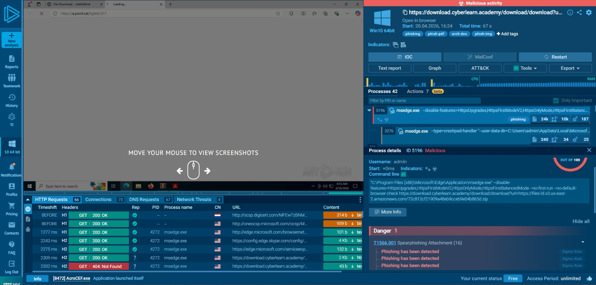
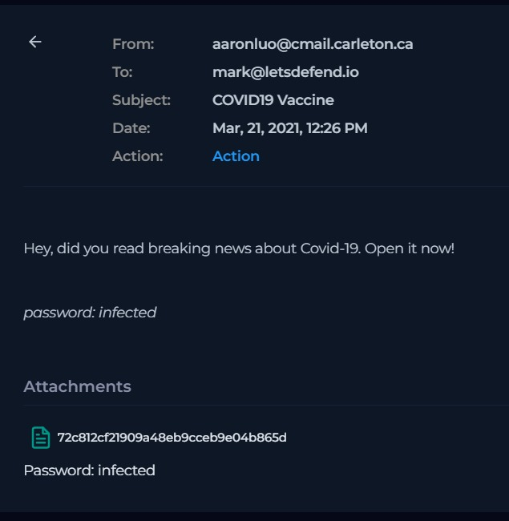
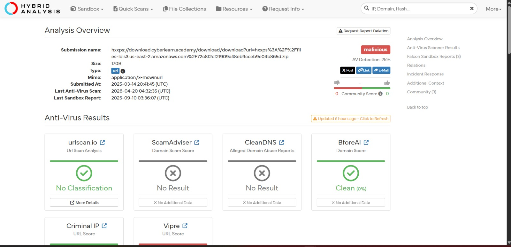
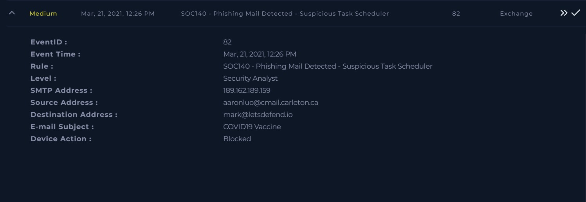

# Investigation report — Phishing Mail Detected – Suspicious Task Scheduler (True Positive)

**Documentation author:** Jayanth K  
**Documentation updated:** 13 October 2026 (Asia/Calcutta)  
**Platform:** LetsDefend  
**Category:** phishing-email-analysis  
**Case ID:** SOC140  
**Documentation status:** Completed
**Lab execution verification:** Not recorded

[Case overview](../README.md) · [Analyst note](../analyst-note.md) · [Evidence index](../evidence-index.md)

## Objective and scope

Organize the existing case narrative and its available screenshots for review. Technical claims in the narrative have not been independently validated against Jayanth K's original lab logs in this workspace.

## Existing investigation narrative

### Investigation Report – Phishing Mail Detected

#### 1. Initial Triage

- Source: aaronluo@cmail.carleton.ca  
- Destination: mark@letsdefend.io  
- Subject: COVID19 Vaccine  
- Device Action: Blocked  

---

#### 2. Email Analysis

- Email contains an attachment URL:
  https://download.cyberlearn.academy/download/download?url=https://files-ld.s3.us-east-2.amazonaws.com/72c812cf21909a48eb9cceb9e04b865d.zip  

- The attachment was analyzed using sandbox platforms:
  - Any.run → flagged as suspicious/malicious  
  - Hybrid Analysis → flagged as malicious  

- Email content and attachment behavior indicate phishing intent  

---

#### 3. Log Analysis

- No additional logs associated with this activity  
- No evidence of execution or lateral movement  

---

#### 4. Correlation Analysis

- Malicious attachment + phishing-themed subject  
- External sender targeting internal user  
- Matches known phishing patterns  

---

#### 5. Conclusion

- Email confirmed as phishing attempt  
- Attachment identified as malicious  
- Threat was blocked before reaching the user  

---

#### 6. Final Verdict

True Positive – Phishing Email (Blocked)

---

#### 7. Learning Outcome

- Sandbox analysis is critical for attachment validation  
- Blocked emails still require investigation  
- Phishing emails often use trending themes (e.g., COVID19)  

---

## Constraints and limitations

- Personal lab execution date: **Not recorded**.
- Original raw logs from that execution: **Not recorded**.
- Personally captured screenshot provenance: **Not recorded**.
- Independent confirmation of verdict and response actions: **Not recorded**.
- Original event timestamps are retained. Their presence is not a documentation update date or proof of recent execution.
- Screenshot account names may have been personalized; identity labels are not execution evidence.

## Evidence register

| Evidence ID | File | Visible content category | Image treatment |
|---|---|---|---|
| E01 | [anyrun.jpeg](../screenshots/anyrun.jpeg) | ANY.RUN sandbox view | Existing image; no additional image edits |
| E02 | [email.jpeg](../screenshots/email.jpeg) | Email content view | Existing image; no additional image edits |
| E03 | [hybrid-analysis.jpeg](../screenshots/hybrid-analysis.jpeg) | Hybrid Analysis result view | Existing image; no additional image edits |
| E04 | [siem-alert.jpeg](../screenshots/siem-alert.jpeg) | SIEM alert view | Existing image; no additional image edits |

## Screenshot evidence

### E01 — ANY.RUN sandbox view

*File: `anyrun.jpeg`. Existing image; no additional image edits. Personal capture date and original log provenance: Not recorded.*

### E02 — Email content view

*File: `email.jpeg`. Existing image; no additional image edits. Personal capture date and original log provenance: Not recorded.*

### E03 — Hybrid Analysis result view

*File: `hybrid-analysis.jpeg`. Existing image; no additional image edits. Personal capture date and original log provenance: Not recorded.*

### E04 — SIEM alert view

*File: `siem-alert.jpeg`. Existing image; no additional image edits. Personal capture date and original log provenance: Not recorded.*

## Documentation closure

The case documents and available images are organized and linked. Live-lab verification remains open until original logs and capture provenance are supplied. No new containment or remediation action is asserted by this documentation update.
