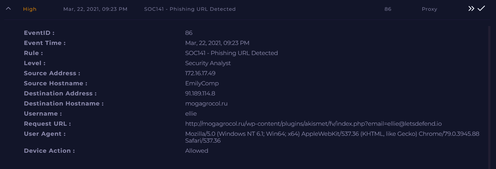
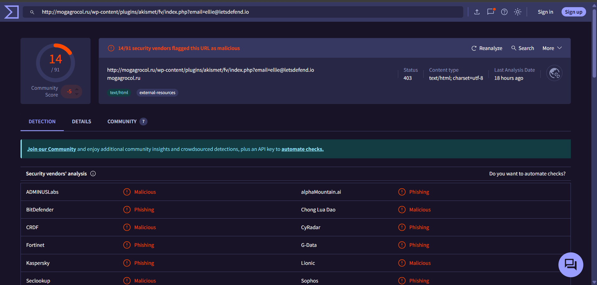

# Investigation report — SOC141 - Phishing URL Detected

**Documentation author:** Jayanth K  
**Documentation updated:** 13 October 2026 (Asia/Calcutta)  
**Platform:** LetsDefend  
**Category:** phishing-email-analysis  
**Case ID:** SOC141  
**Documentation status:** Completed
**Lab execution verification:** Not recorded

[Case overview](../README.md) · [Analyst note](../analyst-note.md) · [Evidence index](../evidence-index.md)

## Quick navigation

[Investigation narrative](#existing-investigation-narrative) · [Evidence register](#evidence-register) · [Screenshots](#screenshot-evidence) · [Limitations](#constraints-and-limitations)

## Objective and scope

Organize the existing case narrative and its available screenshots for review. Technical claims in the narrative have not been independently validated against Jayanth K's original lab logs in this workspace.

## Existing investigation narrative

### 🔍 SOC141 - Phishing URL Detected (Detailed Analysis)

#### 📌 Alert Summary

An alert was triggered indicating that an internal endpoint attempted to access a phishing/malicious URL. The traffic originated from user **ellie** on host **EmilyComp**.

---

#### 🧾 Log Analysis

- **Source IP:** 172.16.17.49  
- **Destination Domain:** mogagrocol.ru  
- **Request Type:** HTTP GET  

##### Observations:
- The URL contains a suspicious query parameter:email=ellie@letsdefend.io

This suggests **data exfiltration or phishing tracking**.

- The domain structure indicates:
- Abuse of **WordPress plugin directory**
- Likely **compromised website hosting malicious script**

---

#### 🦠 Threat Intelligence

- The domain **mogagrocol.ru** is flagged as malicious on **VirusTotal**.
- Likely associated with:
- Phishing campaigns
- Malware delivery
- Command & Control (C2) activity

---

#### 🔐 Security Control Behavior

- First request: ✅ Allowed  
- Subsequent requests: ❌ Blocked by firewall  

##### Interpretation:
- Indicates **initial exposure occurred**
- Security controls responded after detection
- Suggests possible **partial compromise**

---

#### 🖥️ Endpoint Assessment

- Host: EmilyComp  
- Status: **Compromised (Suspected)**  

##### Indicators:
- Access to confirmed malicious URL
- Data passed via URL parameters
- Firewall blocking after initial request

---

#### ⚠️ Risk Assessment

| Risk Factor              | Level |
|--------------------------|------|
| Malware Infection        | High |
| Data Exfiltration        | Medium |
| Credential Exposure      | High |
| Lateral Movement Risk    | Medium |

---

#### 🛠️ Actions Taken

- Endpoint **isolated/contained**
- Malicious domain **blocked**
- Alert validated as **True Positive**
- Escalated to **L2 / Incident Response**

---

#### 🔄 Recommended Actions

##### Immediate:
- Perform **EDR investigation**
- Run **full antivirus/malware scan**
- Reset user credentials (ellie)

##### Further:
- Analyze:
- Process execution logs
- Network connections
- Browser history

- Check for:
- Persistence mechanisms
- Suspicious child processes

---

#### 🧠 Analyst Conclusion

The alert represents a **confirmed phishing/malicious URL access**.  
Although firewall controls blocked subsequent traffic, the **initial successful connection suggests potential compromise**.

➡️ Final Verdict: **True Positive**  
➡️ Status: **Contained, Escalated for Deep Investigation**

---

## Constraints and limitations

- Personal lab execution date: **Not recorded**.
- Original raw logs from that execution: **Not recorded**.
- Personally captured screenshot provenance: **Not recorded**.
- Independent confirmation of verdict and response actions: **Not recorded**.
- Original event timestamps are retained. Their presence is not a documentation update date or proof of recent execution.
- Screenshot account names may have been personalized; identity labels are not execution evidence.

## Evidence register

| Evidence ID | File | Visible content category | Image treatment |
|---|---|---|---|
| E01 | [siem-alert.png](../screenshots/siem-alert.png) | SIEM alert view | Existing image; no additional image edits |
| E02 | [virustotal-report.png](../screenshots/virustotal-report.png) | VirusTotal result view | Existing image; no additional image edits |

## Screenshot evidence

Images fit GitHub's content width. For readable technical text, use **Open full-resolution image**, then click the image to toggle its native size.

### E01 — SIEM alert view

[Open full-resolution image](https://raw.githubusercontent.com/karrijayanth65/SOC-Investigations/refs/heads/main/LetsDefend/phishing-email-analysis/SOC141-Phishing-URL-Detected/screenshots/siem-alert.png)

*File: `siem-alert.png`. Existing image; no additional image edits. Personal capture date and original log provenance: Not recorded.*

### E02 — VirusTotal result view

[Open full-resolution image](https://raw.githubusercontent.com/karrijayanth65/SOC-Investigations/refs/heads/main/LetsDefend/phishing-email-analysis/SOC141-Phishing-URL-Detected/screenshots/virustotal-report.png)

*File: `virustotal-report.png`. Existing image; no additional image edits. Personal capture date and original log provenance: Not recorded.*

## Documentation closure

The case documents and available images are organized and linked. Live-lab verification remains open until original logs and capture provenance are supplied. No new containment or remediation action is asserted by this documentation update.
