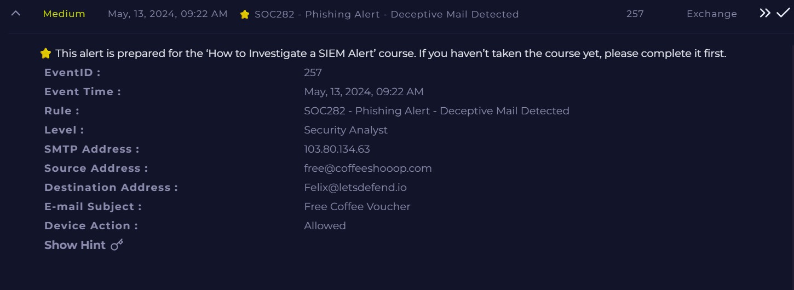

# ☕ Phishing Email Analysis – AsyncRAT Delivery

**Documentation author:** Jayanth K  
**Documentation updated:** 13 October 2026 (Asia/Calcutta)  
**Platform:** LetsDefend  
**Category:** phishing-email-analysis  
**Case ID:** SOC282  
**Documentation status:** Completed
**Lab execution verification:** Not recorded

[Platform index](../../README.md) · [Category index](../README.md) · [Portfolio home](../../../README.md)

## Screenshot preview

[View all screenshots in the report](reports/investigation.md#screenshot-evidence) · [Open this image at full resolution](screenshots/siem-alert.png?raw=true)

*Existing SIEM alert image: `siem-alert.png`. Open the full-resolution image and click it to enlarge small text. Image treatment and provenance are recorded in the [evidence index](evidence-index.md).*

## Case overview

### 📌 Overview

This project documents the analysis of a phishing email that delivered **AsyncRAT malware** via a malicious ZIP attachment disguised as a free coffee voucher.

The objective of this case is to identify malicious indicators, analyze attacker behavior, and document incident response actions.

---

### 📧 Incident Summary

* **Email Subject:** Free Coffee Voucher
* **Sender:** [free@coffeeshooop.com](mailto:free@coffeeshooop.com)
* **Attachment:** free-coffie.zip
* **Malware:** AsyncRAT
* **C2 IP:** 37.120.233.226

The user was tricked into downloading and executing a malicious file (`coffee.exe`) from the ZIP archive, leading to malware execution.

---

### 🚨 Key Findings

* Phishing email used **social engineering (free voucher lure)**
* Attachment contained **AsyncRAT payload**
* Malware attempted communication with **C2 server**
* Suspicious domain with **typosquatting (coffeeshooop.com)**

---

### 🔍 Indicators of Compromise (IOCs)

| Type       | Value                                                 |
| ---------- | ----------------------------------------------------- |
| IP Address | 37.120.233.226                                        |
| Domain     | coffeeshooop.com                                      |
| Email      | [free@coffeeshooop.com](mailto:free@coffeeshooop.com) |
| MD5 Hash   | 73F0F77181E1F06A9DBC41EA9E7A03FE                      |

---

### ⚠️ Impact

If successful, the attack could:

* Provide remote access to attacker
* Steal credentials and sensitive data
* Maintain persistence on the system

---

### 🛡️ Response Actions

* Host was **contained**
* Malicious email was **removed**
* C2 communication was **identified and blocked**
* System marked for **full rebuild (nuke and pave)**
* User account sessions were **terminated**
* Passwords were **reset**

---

### 📚 Learning Outcomes

* Identifying phishing indicators
* Analyzing malware delivery via attachments
* Understanding RAT behavior (AsyncRAT)
* Writing SOC-ready incident reports

---

### 🏁 Conclusion

This case demonstrates how simple phishing lures can lead to full system compromise. Proper user awareness and rapid incident response are critical to minimizing damage.

## Documents and evidence

- [Detailed investigation](reports/investigation.md)
- [Analyst note](analyst-note.md)
- [Evidence index and missing information](evidence-index.md)
- [Screenshots folder](screenshots/)

## Evidence status

3 existing screenshots are linked from the report. Personal execution date, original logs for that execution, and independent validation are **Not recorded**. Preserve the original event timestamps in the narrative. Account-name personalization does not establish who performed the lab.
