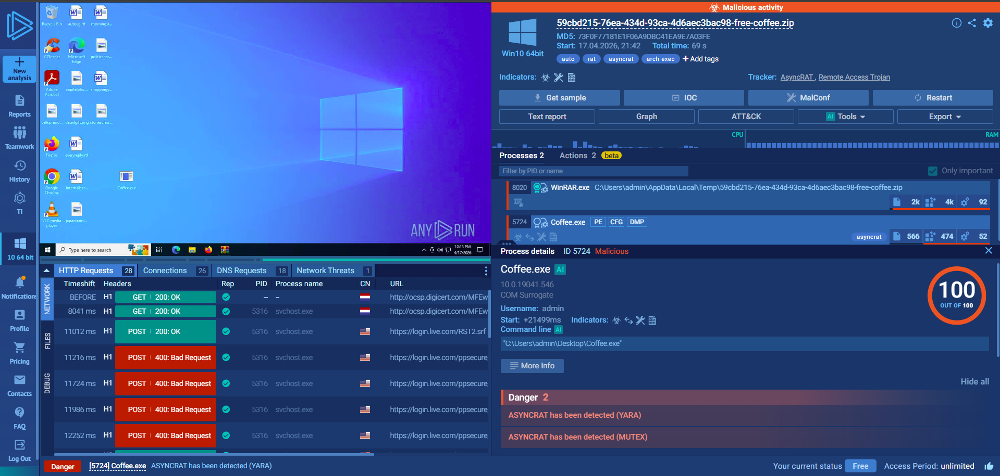
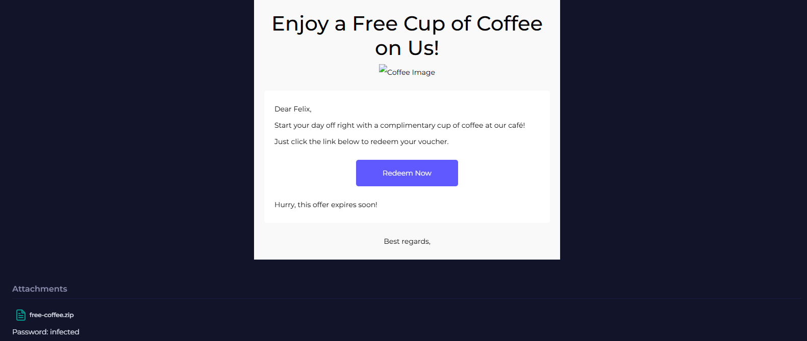

# Investigation report — ☕ Phishing Email Analysis – AsyncRAT Delivery

**Documentation author:** Jayanth K  
**Documentation updated:** 13 October 2026 (Asia/Calcutta)  
**Platform:** LetsDefend  
**Category:** phishing-email-analysis  
**Case ID:** SOC282  
**Documentation status:** Completed
**Lab execution verification:** Not recorded

[Case overview](../README.md) · [Analyst note](../analyst-note.md) · [Evidence index](../evidence-index.md)

## Quick navigation

[Investigation narrative](#existing-investigation-narrative) · [Evidence register](#evidence-register) · [Screenshots](#screenshot-evidence) · [Limitations](#constraints-and-limitations)

## Objective and scope

Organize the existing case narrative and its available screenshots for review. Technical claims in the narrative have not been independently validated against Jayanth K's original lab logs in this workspace.

## Existing investigation narrative

### 🔍 Detailed Analysis – AsyncRAT Phishing Incident

#### 📧 Email Analysis

The email originated from **[free@coffeeshooop.com](mailto:free@coffeeshooop.com)**, a suspicious domain exhibiting typosquatting behavior. The subject “Free Coffee Voucher” was used as a lure to trick the recipient into opening the attachment.

##### Red Flags:

* Misspelled domain (**coffeeshooop**)
* Suspicious attachment (`free-coffie.zip`)
* Unsolicited reward-based email

---

#### 📦 Attachment Analysis

The ZIP file contained an executable named **coffee.exe**.

Upon execution:

* The file deployed **AsyncRAT malware**
* Established persistence mechanisms
* Attempted outbound communication

---

#### 🧪 Malware Behavior

Analysis via sandbox environment revealed:

* Execution of malicious process (`coffee.exe`)
* Network beaconing to external IP
* Indicators consistent with **Remote Access Trojan (RAT)** activity

---

#### 🌐 Network Analysis

* **C2 IP:** 37.120.233.226
* Malware attempted communication with command-and-control server
* Indicates active attacker control capability

---

#### 🔑 Indicators of Compromise (IOCs)

| Indicator Type | Value                                                 |
| -------------- | ----------------------------------------------------- |
| IP Address     | 37.120.233.226                                        |
| Domain         | coffeeshooop.com                                      |
| Email          | [free@coffeeshooop.com](mailto:free@coffeeshooop.com) |
| MD5 Hash       | 73F0F77181E1F06A9DBC41EA9E7A03FE                      |

---

#### ⚠️ Impact Analysis

If left undetected, AsyncRAT could:

* Allow remote control of infected system
* Capture keystrokes and credentials
* Exfiltrate sensitive data
* Spread laterally within the network

---

#### 🛡️ Incident Response

The following actions were taken:

* Infected host was **isolated (contained)**
* Phishing email was **removed from mailbox**
* Malicious IP/domain were **blocked**
* System marked for **rebuild (nuke and pave)**
* All active sessions were **terminated**
* User credentials were **reset**

---

#### 🧠 Analyst Conclusion

This incident was a successful phishing attempt leading to execution of AsyncRAT malware. Quick detection and containment prevented further damage.

The attack highlights the importance of:

* User awareness against phishing
* Email filtering mechanisms
* Rapid SOC response procedures

---

## Constraints and limitations

- Personal lab execution date: **Not recorded**.
- Original raw logs from that execution: **Not recorded**.
- Personally captured screenshot provenance: **Not recorded**.
- Independent confirmation of verdict and response actions: **Not recorded**.
- Original event timestamps are retained. Their presence is not a documentation update date or proof of recent execution.
- Screenshot account names may have been personalized; identity labels are not execution evidence.

## Evidence register

| Evidence ID | File | Visible content category | Image treatment |
|---|---|---|---|
| E01 | [anyrun-report.png](../screenshots/anyrun-report.png) | ANY.RUN sandbox view | Existing image; no additional image edits |
| E02 | [email.png](../screenshots/email.png) | Email content view | Existing image; no additional image edits |
| E03 | [siem-alert.png](../screenshots/siem-alert.png) | SIEM alert view | Existing image; no additional image edits |

## Screenshot evidence

Images fit GitHub's content width. For readable technical text, use **Open full-resolution image**, then click the image to toggle its native size.

### E01 — ANY.RUN sandbox view

[Open full-resolution image](../screenshots/anyrun-report.png?raw=true)

*File: `anyrun-report.png`. Existing image; no additional image edits. Personal capture date and original log provenance: Not recorded.*

### E02 — Email content view

[Open full-resolution image](../screenshots/email.png?raw=true)

*File: `email.png`. Existing image; no additional image edits. Personal capture date and original log provenance: Not recorded.*

### E03 — SIEM alert view

[Open full-resolution image](../screenshots/siem-alert.png?raw=true)

*File: `siem-alert.png`. Existing image; no additional image edits. Personal capture date and original log provenance: Not recorded.*

## Documentation closure

The case documents and available images are organized and linked. Live-lab verification remains open until original logs and capture provenance are supplied. No new containment or remediation action is asserted by this documentation update.
