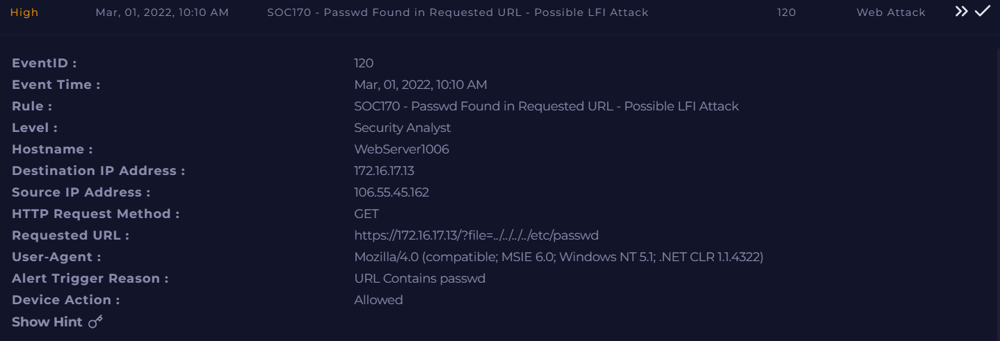
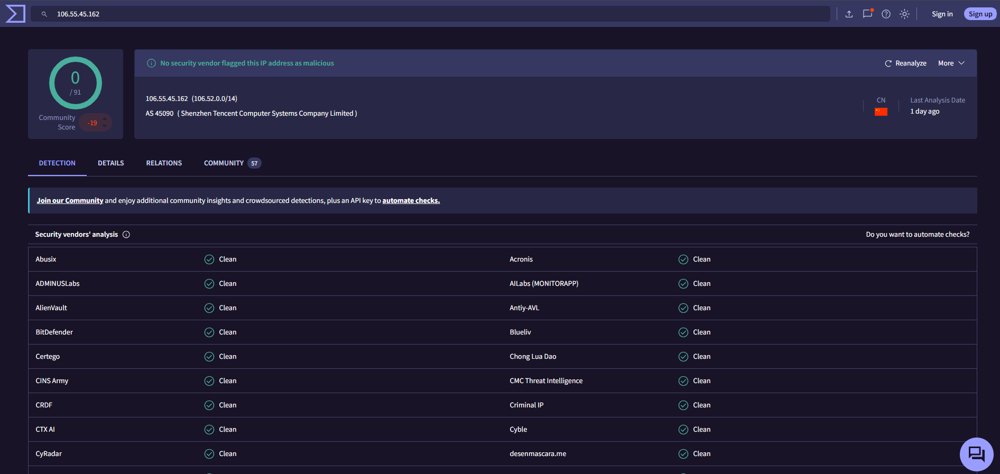

# Investigation report — SOC170 - Passwd Found in Requested URL - Possible LFI Attack

**Documentation author:** Jayanth K  
**Documentation updated:** 13 October 2026 (Asia/Calcutta)  
**Platform:** LetsDefend  
**Category:** web-attack-analysis  
**Case ID:** SOC170  
**Documentation status:** Completed
**Lab execution verification:** Not recorded

[Case overview](../README.md) · [Analyst note](../analyst-note.md) · [Evidence index](../evidence-index.md)

## Quick navigation

[Investigation narrative](#existing-investigation-narrative) · [Evidence register](#evidence-register) · [Screenshots](#screenshot-evidence) · [Limitations](#constraints-and-limitations)

## Objective and scope

Organize the existing case narrative and its available screenshots for review. Technical claims in the narrative have not been independently validated against Jayanth K's original lab logs in this workspace.

## Existing investigation narrative

### Investigation Report

#### Alert Information

| Field          | Value                                                        |
| -------------- | ------------------------------------------------------------ |
| Event ID       | 120                                                          |
| Rule           | SOC170 - Passwd Found in Requested URL - Possible LFI Attack |
| Hostname       | WebServer1006                                                |
| Source IP      | 106.55.45.162                                                |
| Destination IP | 172.16.17.13                                                 |
| HTTP Method    | GET                                                          |
| Device Action  | Allowed                                                      |

#### Observations

##### Suspicious Request

The following URL was requested:

https://172.16.17.13/?file=../../../../etc/passwd

The attacker attempted to traverse directories and access the sensitive Linux file `/etc/passwd`, a common indicator of Local File Inclusion (LFI) exploitation attempts.

##### Threat Intelligence Review

###### VirusTotal

* Source IP: 106.55.45.162
* Result: 0 security vendors flagged the IP as malicious.

###### Cisco Talos

* Reputation: Neutral

##### Server Response Analysis

* HTTP Status Code: 500
* Response Size: 0 Bytes

The web server generated an internal error and did not return any file content to the requester.

##### Environment Validation

The destination host is a Windows server.

Since `/etc/passwd` is a Linux system file and does not exist on Windows systems, the requested resource could not be accessed.

#### Assessment

An external actor originating from China attempted to exploit a possible LFI vulnerability by requesting the Linux password file through directory traversal techniques.

The attack was unsuccessful because:

1. The target server is Windows-based.
2. The requested Linux file does not exist on the host.
3. No file content was returned.
4. The server responded with HTTP 500 Internal Server Error.

#### Verdict

* True Positive
* Malicious LFI Attempt Detected
* Exploitation Failed
* No Evidence of Data Exposure

## Constraints and limitations

- Personal lab execution date: **Not recorded**.
- Original raw logs from that execution: **Not recorded**.
- Personally captured screenshot provenance: **Not recorded**.
- Independent confirmation of verdict and response actions: **Not recorded**.
- Original event timestamps are retained. Their presence is not a documentation update date or proof of recent execution.
- Screenshot account names may have been personalized; identity labels are not execution evidence.

## Evidence register

| Evidence ID | File | Visible content category | Image treatment |
|---|---|---|---|
| E01 | [siem-alert.png](../screenshots/siem-alert.png) | SIEM alert view | Existing image; no additional image edits |
| E02 | [virustotal.png](../screenshots/virustotal.png) | VirusTotal result view | Existing image; no additional image edits |

## Screenshot evidence

Images fit GitHub's content width. For readable technical text, use **Open full-resolution image**, then click the image to toggle its native size.

### E01 — SIEM alert view

[Open full-resolution image](../screenshots/siem-alert.png?raw=true)

*File: `siem-alert.png`. Existing image; no additional image edits. Personal capture date and original log provenance: Not recorded.*

### E02 — VirusTotal result view

[Open full-resolution image](../screenshots/virustotal.png?raw=true)

*File: `virustotal.png`. Existing image; no additional image edits. Personal capture date and original log provenance: Not recorded.*

## Documentation closure

The case documents and available images are organized and linked. Live-lab verification remains open until original logs and capture provenance are supplied. No new containment or remediation action is asserted by this documentation update.
