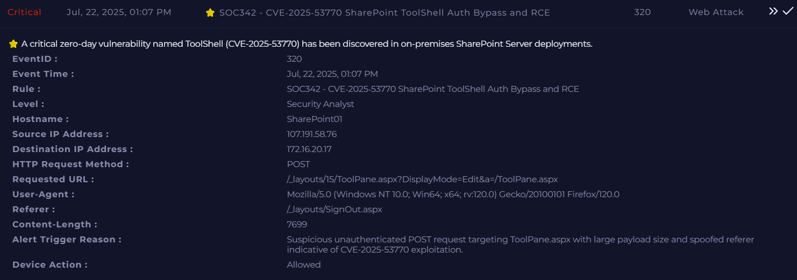
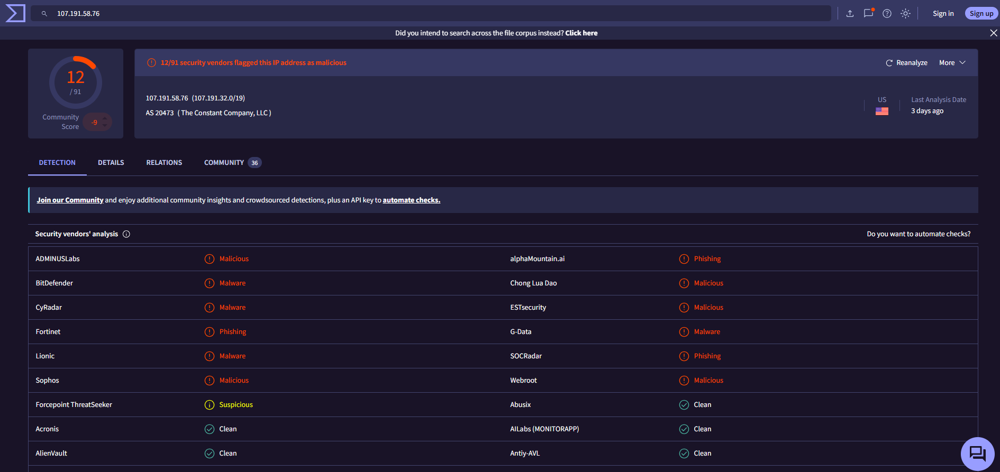

# Investigation report — SOC342 - CVE-2025-53770 SharePoint ToolShell Auth Bypass and RCE

**Documentation author:** Jayanth K  
**Documentation updated:** 13 October 2026 (Asia/Calcutta)  
**Platform:** LetsDefend  
**Category:** web-attack-analysis  
**Case ID:** SOC342  
**Documentation status:** Completed
**Lab execution verification:** Not recorded

[Case overview](../README.md) · [Analyst note](../analyst-note.md) · [Evidence index](../evidence-index.md)

## Objective and scope

Organize the existing case narrative and its available screenshots for review. Technical claims in the narrative have not been independently validated against Jayanth K's original lab logs in this workspace.

## Existing investigation narrative

### Investigation Report

#### Incident Summary

| Field          | Value                                                            |
| -------------- | ---------------------------------------------------------------- |
| Alert Name     | SOC342 - CVE-2025-53770 SharePoint ToolShell Auth Bypass and RCE |
| Event ID       | 320                                                              |
| Severity       | Critical                                                         |
| Classification | Confirmed True Positive                                          |
| Hostname       | SharePoint01                                                     |
| Destination IP | 172.16.20.17                                                     |
| Source IP      | 107.191.58.76                                                    |
| Event Time     | 22-Jul-2025 01:07 PM                                             |

#### Alert Description

A critical alert was generated after a suspicious HTTP POST request targeted SharePoint ToolPane.aspx. The request characteristics were consistent with exploitation attempts associated with CVE-2025-53770 (ToolShell), a vulnerability affecting on-premises SharePoint deployments that may allow authentication bypass and remote code execution.

#### Initial Observations

##### Network Activity

HTTP Method:
POST

Requested URL:
/_layouts/15/ToolPane.aspx?DisplayMode=Edit&a=/ToolPane.aspx

Referer:
/_layouts/SignOut.aspx

Content Length:
7699 bytes

User Agent:
Mozilla/5.0 (Windows NT 10.0; Win64; x64; rv:120.0) Gecko/20100101 Firefox/120.0

##### Detection Reason

The alert was triggered because of:

* Unauthenticated POST request
* Targeting of ToolPane.aspx
* Large payload size
* Suspicious Referer value
* Known CVE-2025-53770 exploitation pattern

#### Threat Intelligence Validation

The source IP address 107.191.58.76 was reviewed through threat intelligence sources.

Finding:

* Multiple security vendors identified the IP as malicious.
* The IP has known associations with malicious activity.

Assessment:

The source was considered highly suspicious and likely associated with active exploitation attempts.

#### Endpoint Investigation

Endpoint telemetry and forensic evidence from SharePoint01 confirmed post-exploitation activity.

##### PowerShell Execution

A Base64-encoded PowerShell payload was identified.

Observed behavior:

* Execution of encoded PowerShell commands
* Extraction of SharePoint Machine Keys
* Post-exploitation actions performed on the server

##### Malicious Artifacts

The following files were discovered:

###### payload.exe

Location:
Windows Temp directory

Purpose:
Malicious executable dropped following successful exploitation.

###### spinstall0.aspx

Location:
SharePoint LAYOUTS directory

Purpose:
Webshell used to maintain persistence and execute commands remotely.

###### notes.txt

Location:
Discovered during endpoint investigation.

Purpose:
Associated artifact created during attacker activity.

#### Attack Chain

1. Attacker initiated an unauthenticated POST request.
2. SharePoint ToolPane.aspx endpoint was exploited.
3. Remote code execution was achieved.
4. Encoded PowerShell payload executed.
5. SharePoint Machine Keys were extracted.
6. payload.exe was dropped to the server.
7. spinstall0.aspx webshell was deployed.
8. Attacker established persistence and post-exploitation access.

#### Impact Assessment

Confirmed impacts include:

* Unauthorized access to SharePoint server
* Remote code execution
* Machine Key extraction
* Deployment of malicious executable
* Installation of webshell
* Persistence mechanism established on host

Potential risks:

* Credential compromise
* Session forgery
* Lateral movement
* Additional malware deployment
* Data access or exfiltration

#### Containment Actions

The following actions were performed:

* Isolated SharePoint01 from the network
* Contained affected endpoint
* Removed payload.exe
* Removed spinstall0.aspx
* Removed notes.txt
* Blocked identified IOCs
* Initiated incident response procedures

#### Remediation

Recommended remediation steps:

* Apply vendor security updates for CVE-2025-53770
* Rotate SharePoint Machine Keys
* Reset privileged credentials
* Review authentication logs
* Conduct environment-wide IOC hunting
* Verify webroot integrity
* Rebuild compromised systems if required
* Perform post-remediation validation

#### Conclusion

Investigation confirmed successful exploitation of CVE-2025-53770 against SharePoint01 from source IP 107.191.58.76. The attacker achieved remote code execution, executed malicious PowerShell payloads, extracted Machine Keys, dropped payload.exe, and deployed the spinstall0.aspx webshell.

The affected host was contained, malicious artifacts were removed, IOCs were blocked, and remediation activities were initiated. The incident is classified as a Confirmed True Positive involving SharePoint compromise and webshell deployment.

## Constraints and limitations

- Personal lab execution date: **Not recorded**.
- Original raw logs from that execution: **Not recorded**.
- Personally captured screenshot provenance: **Not recorded**.
- Independent confirmation of verdict and response actions: **Not recorded**.
- Original event timestamps are retained. Their presence is not a documentation update date or proof of recent execution.
- Screenshot account names may have been personalized; identity labels are not execution evidence.

## Evidence register

| Evidence ID | File | Visible content category | Image treatment |
|---|---|---|---|
| E01 | [siem-alert.png](../screenshots/siem-alert.png) | SIEM alert view | Existing image; no additional image edits |
| E02 | [virustotal.png](../screenshots/virustotal.png) | VirusTotal result view | Existing image; no additional image edits |

## Screenshot evidence

### E01 — SIEM alert view

*File: `siem-alert.png`. Existing image; no additional image edits. Personal capture date and original log provenance: Not recorded.*

### E02 — VirusTotal result view

*File: `virustotal.png`. Existing image; no additional image edits. Personal capture date and original log provenance: Not recorded.*

## Documentation closure

The case documents and available images are organized and linked. Live-lab verification remains open until original logs and capture provenance are supplied. No new containment or remediation action is asserted by this documentation update.
