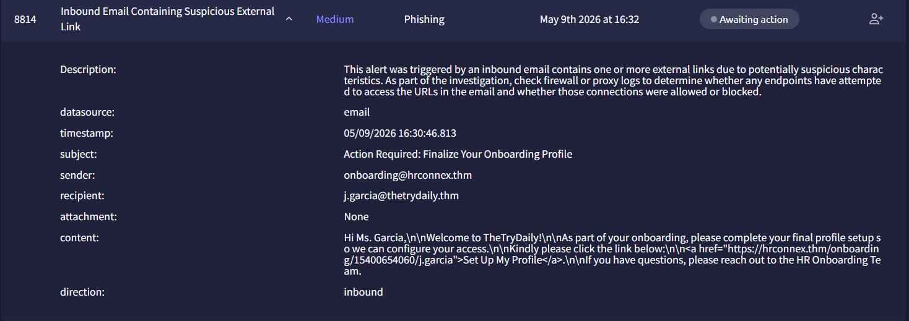

# Inbound Email Containing Suspicious External Link - Investigation

**Documentation author:** Jayanth K  
**Documentation updated:** 13 October 2026 (Asia/Calcutta)  
**Platform:** TryHackMe  
**Category:** phishing-email-analysis  
**Case ID:** 8814  
**Documentation status:** Completed
**Lab execution verification:** Not recorded

[Platform index](../../README.md) · [Category index](../README.md) · [Portfolio home](../../../README.md)

## Screenshot preview

[View all screenshots in the report](reports/investigation.md#screenshot-evidence) · [Open this image at full resolution](https://raw.githubusercontent.com/karrijayanth65/SOC-Investigations/refs/heads/main/TryHackMe/phishing-email-analysis/8814-Email-Containing-Suspicious-External-Link/screenshots/siem-alert.png)

*Existing SIEM alert image: `siem-alert.png`. Open the full-resolution image and click it to enlarge small text. Image treatment and provenance are recorded in the [evidence index](evidence-index.md).*

## Case overview

### Alert Information
- **Alert ID:** 8814
- **Alert Name:** Inbound Email Containing Suspicious External Link
- **Severity:** Medium
- **Category:** Phishing
- **Status:** Awaiting Action
- **Date:** May 9, 2026

### Objective
Investigate the suspicious inbound email containing an external onboarding link and determine whether the email is malicious or a false positive.

### Investigation Summary
The investigation focused on:
- Reviewing the sender domain reputation
- Analyzing the embedded onboarding URL
- Searching Splunk logs for URL access attempts
- Verifying indicators using TryDetectThis

### Key Findings
- The sender domain `hrconnex.thm` was analyzed and found to be clean.
- The embedded URL did not contain known malicious indicators.
- No suspicious activity or malicious network connections were identified.
- Splunk searches did not reveal any malicious endpoint communication related to the URL.

### Final Verdict
**False Positive**

The sender domain and embedded link appear legitimate with no malicious indicators detected during analysis.

## Documents and evidence

- [Detailed investigation](reports/investigation.md)
- [Analyst note](analyst-note.md)
- [Evidence index and missing information](evidence-index.md)
- [Screenshots folder](screenshots/)

## Evidence status

3 existing screenshots are linked from the report. Personal execution date, original logs for that execution, and independent validation are **Not recorded**. Preserve the original event timestamps in the narrative. Account-name personalization does not establish who performed the lab.
