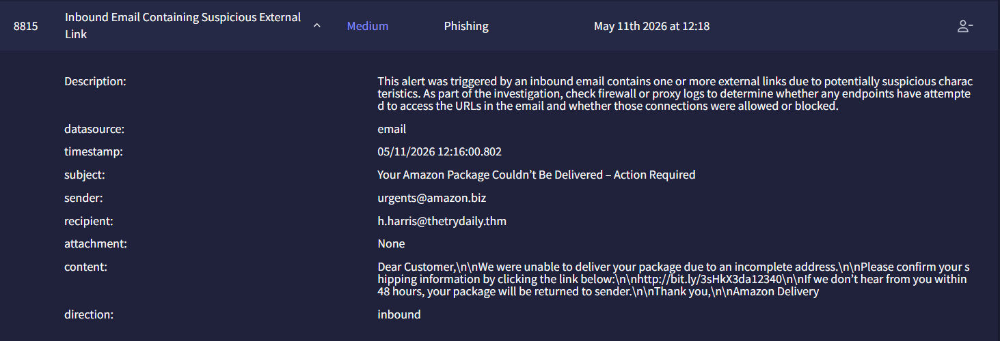
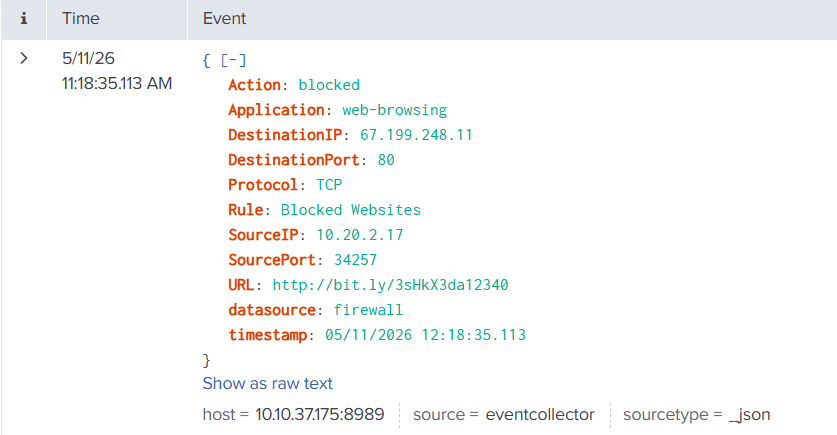
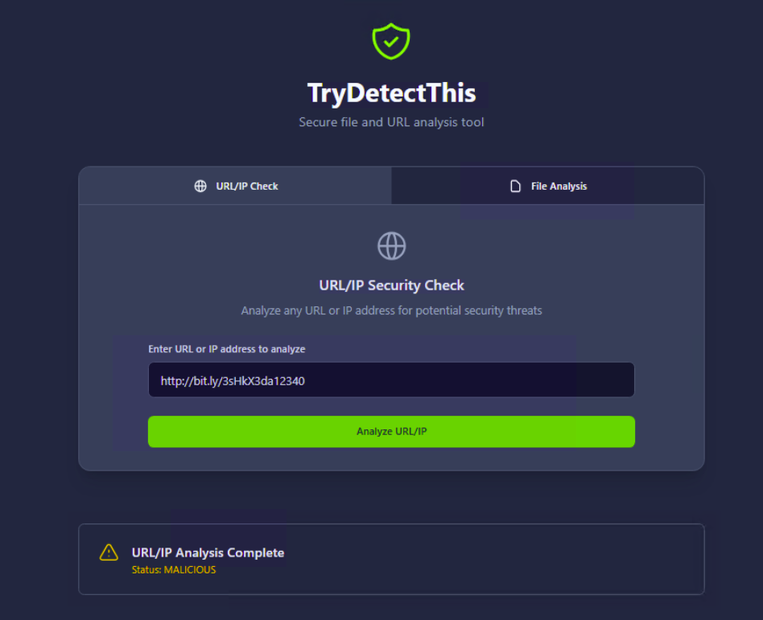

# Investigation report — Inbound Email Containing Suspicious External Link - Investigation

**Documentation author:** Jayanth K  
**Documentation updated:** 13 October 2026 (Asia/Calcutta)  
**Platform:** TryHackMe  
**Category:** phishing-email-analysis  
**Case ID:** 8815  
**Documentation status:** Completed
**Lab execution verification:** Not recorded

[Case overview](../README.md) · [Analyst note](../analyst-note.md) · [Evidence index](../evidence-index.md)

## Objective and scope

Organize the existing case narrative and its available screenshots for review. Technical claims in the narrative have not been independently validated against Jayanth K's original lab logs in this workspace.

## Existing investigation narrative

### Detailed Investigation Report

#### Alert Details

| Field | Value |
|---|---|
| Alert ID | 8815 |
| Alert Name | Inbound Email Containing Suspicious External Link |
| Severity | Medium |
| Category | Phishing |
| Timestamp | 05/11/2026 12:16:00.802 |
| Sender | urgents@amazon.biz |
| Recipient | h.harris@thetrydaily.thm |
| Subject | Your Amazon Package Couldn’t Be Delivered – Action Required |
| Attachment | None |
| Direction | Inbound |

---

#### Email Content

```html
Dear Customer,

We were unable to deliver your package due to an incomplete address.

Please confirm your shipping information by clicking the link below:

http://bit.ly/3sHkX3da12340

If we don’t hear from you within 48 hours, your package will be returned to sender.

Thank you,

Amazon Delivery
```

---

### Investigation Steps

#### 1. URL Analysis in Splunk

Searched the following URL in Splunk logs:

```text
http://bit.ly/3sHkX3da12340
```

##### Result

- Security controls blocked the message.
- The URL was identified as suspicious/malicious.
- No successful access to the malicious destination was observed.

---

#### 2. URL Reputation Analysis

Analyzed URL:

```text
http://bit.ly/3sHkX3da12340
```

Using:
- TryDetectThis (AnalystVM)

##### Result

- Reputation status: Malicious
- URL flagged as phishing/malicious activity.

---

### Analysis

The email impersonates Amazon delivery services and attempts to create urgency by claiming package delivery failure.

#### Suspicious Characteristics Observed

- Sender domain `amazon.biz` is not an official Amazon domain.
- Use of URL shortening service (`bit.ly`) to obscure the final destination.
- Urgent social engineering language designed to pressure the recipient.
- Malicious URL confirmed by TryDetectThis analysis.
- Email was blocked by security controls.

These indicators strongly suggest a phishing attempt intended to harvest user information or redirect users to a malicious website.

---

### Final Verdict

#### Classification: True Positive

The email contains a confirmed malicious URL and exhibits multiple phishing indicators. The message was appropriately blocked by security controls.

## Constraints and limitations

- Personal lab execution date: **Not recorded**.
- Original raw logs from that execution: **Not recorded**.
- Personally captured screenshot provenance: **Not recorded**.
- Independent confirmation of verdict and response actions: **Not recorded**.
- Original event timestamps are retained. Their presence is not a documentation update date or proof of recent execution.
- Screenshot account names may have been personalized; identity labels are not execution evidence.

## Evidence register

| Evidence ID | File | Visible content category | Image treatment |
|---|---|---|---|
| E01 | [siem-alert.png](../screenshots/siem-alert.png) | SIEM alert view | Existing image; no additional image edits |
| E02 | [splunk-log.png](../screenshots/splunk-log.png) | Splunk event view | Existing image; no additional image edits |
| E03 | [trydetectthis-report.png](../screenshots/trydetectthis-report.png) | TryDetectThis result view | Existing image; no additional image edits |

## Screenshot evidence

### E01 — SIEM alert view



*File: `siem-alert.png`. Existing image; no additional image edits. Personal capture date and original log provenance: Not recorded.*

### E02 — Splunk event view



*File: `splunk-log.png`. Existing image; no additional image edits. Personal capture date and original log provenance: Not recorded.*

### E03 — TryDetectThis result view



*File: `trydetectthis-report.png`. Existing image; no additional image edits. Personal capture date and original log provenance: Not recorded.*

## Documentation closure

The case documents and available images are organized and linked. Live-lab verification remains open until original logs and capture provenance are supplied. No new containment or remediation action is asserted by this documentation update.
