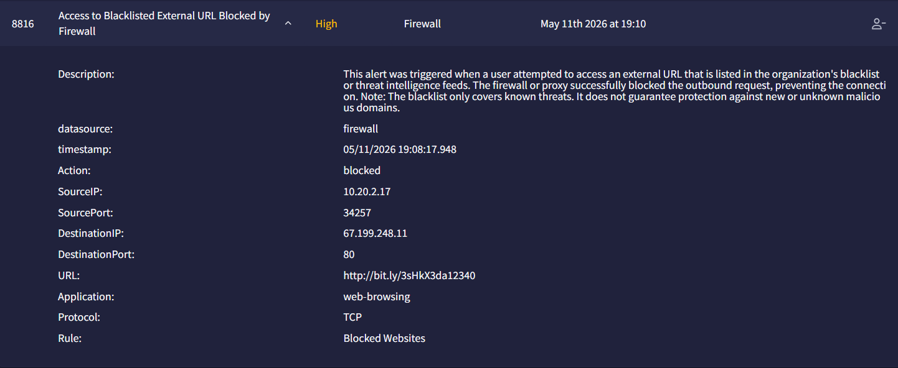
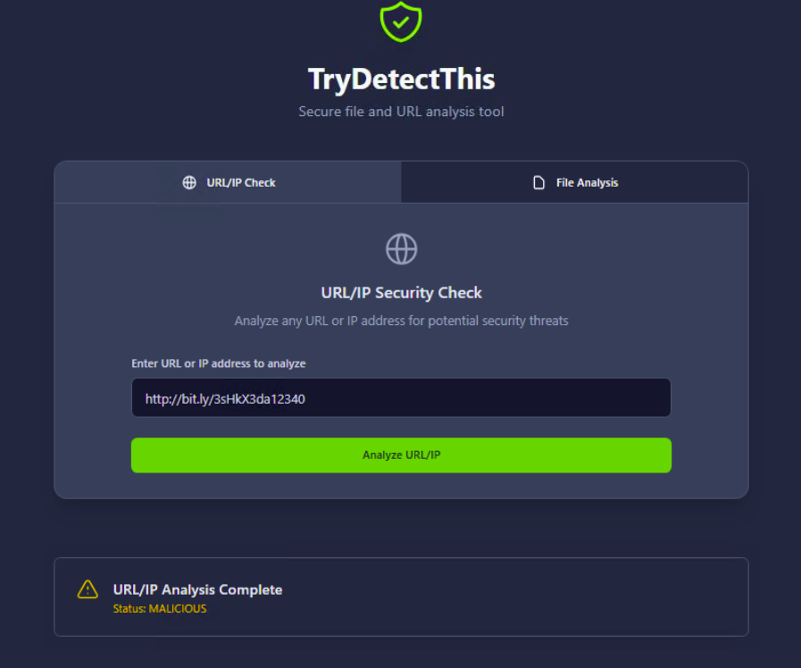

# Investigation report — Access to Blacklisted External URL Blocked by Firewall - Investigation

**Documentation author:** Jayanth K  
**Documentation updated:** 13 October 2026 (Asia/Calcutta)  
**Platform:** TryHackMe  
**Category:** phishing-email-analysis  
**Case ID:** 8816  
**Documentation status:** Completed
**Lab execution verification:** Not recorded

[Case overview](../README.md) · [Analyst note](../analyst-note.md) · [Evidence index](../evidence-index.md)

## Objective and scope

Organize the existing case narrative and its available screenshots for review. Technical claims in the narrative have not been independently validated against Jayanth K's original lab logs in this workspace.

## Existing investigation narrative

### Detailed Investigation Report

#### Alert Details

| Field | Value |
|---|---|
| Alert ID | 8816 |
| Alert Name | Access to Blacklisted External URL Blocked by Firewall |
| Datasource | Firewall |
| Timestamp | 05/11/2026 19:08:17.948 |
| Action | Blocked |
| Source IP | 10.20.2.17 |
| Source Port | 34257 |
| Destination IP | 67.199.248.11 |
| Destination Port | 80 |
| URL | http://bit.ly/3sHkX3da12340 |
| Application | web-browsing |
| Protocol | TCP |
| Firewall Rule | Blocked Websites |

---

### Investigation Steps

#### 1. Firewall Log Review

Reviewed firewall logs for the following URL:

```text
http://bit.ly/3sHkX3da12340
```

##### Result

- Firewall action: Blocked
- Connection attempt was denied successfully.
- No successful outbound communication occurred.

---

#### 2. URL Reputation Analysis

Analyzed URL:

```text
http://bit.ly/3sHkX3da12340
```

Using:
- TryDetectThis

##### Result

- Reputation status: Malicious
- URL identified as malicious/phishing infrastructure.

---

### Analysis

The alert indicates that an internal host attempted to access a malicious external URL.

#### Observed Characteristics

- URL is confirmed malicious.
- Firewall security policy successfully blocked the traffic.
- No evidence of successful communication with the malicious host.
- Existing security controls operated as expected.

#### Impact Assessment

The attempted connection was prevented by the firewall, reducing the likelihood of compromise.

No additional malicious activity was observed during the investigation.

---

### Recommended Actions

- Continue monitoring the source host `10.20.2.17` for suspicious behavior.
- Maintain current firewall blocking policies.
- Educate users regarding suspicious shortened URLs.

---

### Final Verdict

#### Classification: True Positive

The URL is confirmed malicious. The firewall successfully blocked the connection attempt, and no escalation is required at this time.

## Constraints and limitations

- Personal lab execution date: **Not recorded**.
- Original raw logs from that execution: **Not recorded**.
- Personally captured screenshot provenance: **Not recorded**.
- Independent confirmation of verdict and response actions: **Not recorded**.
- Original event timestamps are retained. Their presence is not a documentation update date or proof of recent execution.
- Screenshot account names may have been personalized; identity labels are not execution evidence.

## Evidence register

| Evidence ID | File | Visible content category | Image treatment |
|---|---|---|---|
| E01 | [siem-alert.png](../screenshots/siem-alert.png) | SIEM alert view | Existing image; no additional image edits |
| E02 | [trydetectthis.png](../screenshots/trydetectthis.png) | TryDetectThis result view | Existing image; no additional image edits |

## Screenshot evidence

### E01 — SIEM alert view



*File: `siem-alert.png`. Existing image; no additional image edits. Personal capture date and original log provenance: Not recorded.*

### E02 — TryDetectThis result view



*File: `trydetectthis.png`. Existing image; no additional image edits. Personal capture date and original log provenance: Not recorded.*

## Documentation closure

The case documents and available images are organized and linked. Live-lab verification remains open until original logs and capture provenance are supplied. No new containment or remediation action is asserted by this documentation update.
