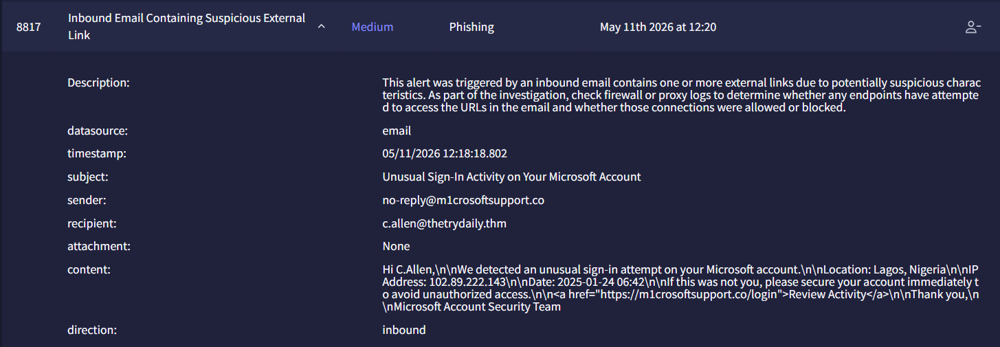
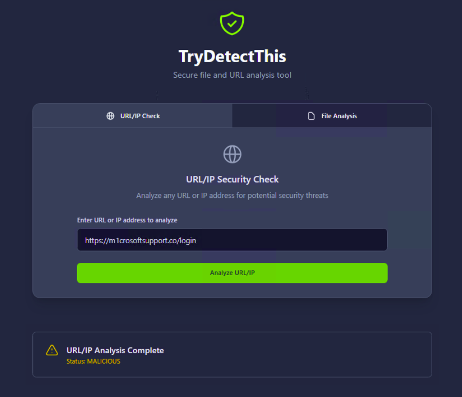

# Investigation report — Inbound Email Containing Suspicious External Link - Investigation

**Documentation author:** Jayanth K  
**Documentation updated:** 13 October 2026 (Asia/Calcutta)  
**Platform:** TryHackMe  
**Category:** phishing-email-analysis  
**Case ID:** 8817  
**Status:** Documentation organized; personal lab execution not verified

[Case overview](../README.md) · [Analyst note](../analyst-note.md) · [Evidence index](../evidence-index.md)

## Objective and scope

Organize the existing case narrative and its available screenshots for review. Technical claims in the narrative have not been independently validated against Jayanth K's original lab logs in this workspace.

## Existing investigation narrative

### Detailed Investigation Report

#### Alert Details

| Field | Value |
|---|---|
| Alert ID | 8817 |
| Alert Name | Inbound Email Containing Suspicious External Link |
| Severity | Medium |
| Category | Phishing |
| Timestamp | 05/11/2026 12:18:18.802 |
| Sender | no-reply@m1crosoftsupport.co |
| Recipient | c.allen@thetrydaily.thm |
| Subject | Unusual Sign-In Activity on Your Microsoft Account |
| Attachment | None |
| Direction | Inbound |

---

#### Email Content

```html
Hi C.Allen,

We detected an unusual sign-in attempt on your Microsoft account.

Location: Lagos, Nigeria

IP Address: 102.89.222.143

Date: 2025-01-24 06:42

If this was not you, please secure your account immediately to avoid unauthorized access.

<a href="https://m1crosoftsupport.co/login">Review Activity</a>

Thank you,

Microsoft Account Security Team
```

---

### Investigation Steps

#### 1. URL Analysis in Splunk

Searched the following URL in Splunk logs:

```text
https://m1crosoftsupport.co/login
```

##### Result

- Connection action status: Allowed
- The email was not blocked by security controls.
- Potential risk exists if the user interacted with the link.

---

#### 2. URL Reputation Analysis

Analyzed URL:

```text
https://m1crosoftsupport.co/login
```

Using:
- TryDetectThis

##### Result

- Reputation status: Malicious
- URL identified as phishing infrastructure.

---

### Analysis

The email impersonates Microsoft account security services and attempts to trick the user into clicking a malicious login page.

#### Suspicious Characteristics Observed

- Typosquatted domain `m1crosoftsupport.co` impersonating Microsoft.
- Fear-based social engineering regarding suspicious sign-in activity.
- Fake account compromise notification.
- Malicious phishing URL confirmed by TryDetectThis.
- External IP address included to increase legitimacy.

#### Potential Impact

If the user accessed the phishing page and entered credentials, account compromise may occur.

---

### Recommended Actions

- Force password reset / credential rotation for the affected user.
- Block sender domain `m1crosoftsupport.co`.
- Block malicious IP address `102.89.222.143`.
- Review authentication logs for suspicious login activity.
- Monitor for additional phishing attempts targeting users.

---

### Final Verdict

#### Classification: True Positive

The email is a confirmed phishing attempt leveraging a malicious typosquatted domain impersonating Microsoft.

## Constraints and limitations

- Personal lab execution date: **Not recorded**.
- Original raw logs from that execution: **Not recorded**.
- Personally captured screenshot provenance: **Not recorded**.
- Independent confirmation of verdict and response actions: **Not recorded**.
- Original event timestamps are retained. Their presence is not a documentation update date or proof of recent execution.
- Screenshot account names may have been personalized; identity labels are not execution evidence.

## Evidence register

| Evidence ID | File | Visible content category | Image treatment |
|---|---|---|---|
| E01 | [siem-alert.png](../screenshots/siem-alert.png) | SIEM alert view | Existing image; no additional image edits |
| E02 | [trydetectthis-report.png](../screenshots/trydetectthis-report.png) | TryDetectThis result view | Existing image; no additional image edits |

## Screenshot evidence

### E01 — SIEM alert view



*File: `siem-alert.png`. Existing image; no additional image edits. Personal capture date and original log provenance: Not recorded.*

### E02 — TryDetectThis result view



*File: `trydetectthis-report.png`. Existing image; no additional image edits. Personal capture date and original log provenance: Not recorded.*

## Documentation closure

The case documents and available images are organized and linked. Live-lab verification remains open until original logs and capture provenance are supplied. No new containment or remediation action is asserted by this documentation update.
