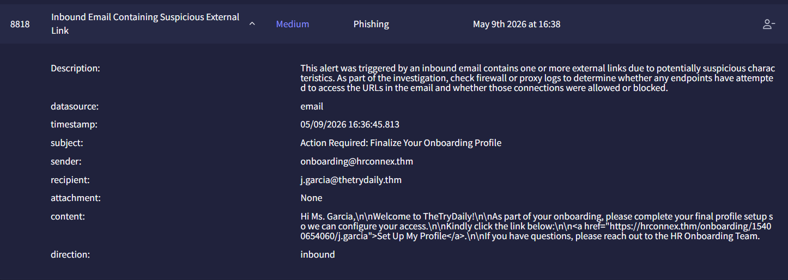

# Investigation report — Inbound Email Containing Suspicious External Link - Investigation

**Documentation author:** Jayanth K  
**Documentation updated:** 13 October 2026 (Asia/Calcutta)  
**Platform:** TryHackMe  
**Category:** phishing-email-analysis  
**Case ID:** 8818  
**Documentation status:** Completed
**Lab execution verification:** Not recorded

[Case overview](../README.md) · [Analyst note](../analyst-note.md) · [Evidence index](../evidence-index.md)

## Quick navigation

[Investigation narrative](#existing-investigation-narrative) · [Evidence register](#evidence-register) · [Screenshots](#screenshot-evidence) · [Limitations](#constraints-and-limitations)

## Objective and scope

Organize the existing case narrative and its available screenshots for review. Technical claims in the narrative have not been independently validated against Jayanth K's original lab logs in this workspace.

## Existing investigation narrative

### Detailed Investigation Report

#### Alert Details

| Field | Value |
|---|---|
| Alert ID | 8818 |
| Alert Name | Inbound Email Containing Suspicious External Link |
| Severity | Medium |
| Category | Phishing |
| Timestamp | 05/09/2026 16:30:46.813 |
| Sender | onboarding@hrconnex.thm |
| Recipient | j.garcia@thetrydaily.thm |
| Subject | Action Required: Finalize Your Onboarding Profile |
| Attachment | None |
| Direction | Inbound |

---

#### Email Content

```html
Hi Ms. Garcia,

Welcome to TheTryDaily!

As part of your onboarding, please complete your final profile setup so we can configure your access.

Kindly please click the link below:

https://hrconnex.thm/onboarding/15400654060/j.garcia

If you have questions, please reach out to the HR Onboarding Team.
```

---

### Investigation Steps

#### 1. URL Analysis in Splunk

Searched the following URL in Splunk logs:

```text
https://hrconnex.thm/onboarding/15400654060/j.garcia
```

##### Result

- No suspicious outbound connections detected.
- No blocked or malicious communication observed.
- No evidence of compromise associated with the URL.

---

#### 2. Sender Domain Reputation Check

Analyzed sender domain:

```text
onboarding@hrconnex.thm
```

Using:
- TryDetectThis

##### Result

- Reputation status: Clean
- No malicious indicators identified.

---

#### 3. URL Reputation Analysis

Analyzed URL:

```text
https://hrconnex.thm/onboarding/15400654060/j.garcia
```

Using:
- TryDetectThis

##### Result

- Reputation status: Clean
- No phishing, malware, or malicious indicators detected.

---

### Analysis

The email resembles a standard onboarding communication requesting the user to finalize their employee onboarding profile.

#### Observed Characteristics

- No malicious attachments
- No suspicious redirects identified
- Sender domain reputation is clean
- URL reputation is clean
- No suspicious activity found in Splunk logs

No indicators of compromise (IOCs) were identified during the investigation.

---

### Final Verdict

#### Classification: False Positive

The sender domain and embedded onboarding URL appear legitimate and benign. No evidence of phishing or malicious activity was identified during the investigation.

## Constraints and limitations

- Personal lab execution date: **Not recorded**.
- Original raw logs from that execution: **Not recorded**.
- Personally captured screenshot provenance: **Not recorded**.
- Independent confirmation of verdict and response actions: **Not recorded**.
- Original event timestamps are retained. Their presence is not a documentation update date or proof of recent execution.
- Screenshot account names may have been personalized; identity labels are not execution evidence.

## Evidence register

| Evidence ID | File | Visible content category | Image treatment |
|---|---|---|---|
| E01 | [siem-alert.png](../screenshots/siem-alert.png) | SIEM alert view | Existing image; no additional image edits |

## Screenshot evidence

Images fit GitHub's content width. For readable technical text, use **Open full-resolution image**, then click the image to toggle its native size.

### E01 — SIEM alert view

[Open full-resolution image](../screenshots/siem-alert.png?raw=true)



*File: `siem-alert.png`. Existing image; no additional image edits. Personal capture date and original log provenance: Not recorded.*

## Documentation closure

The case documents and available images are organized and linked. Live-lab verification remains open until original logs and capture provenance are supplied. No new containment or remediation action is asserted by this documentation update.
